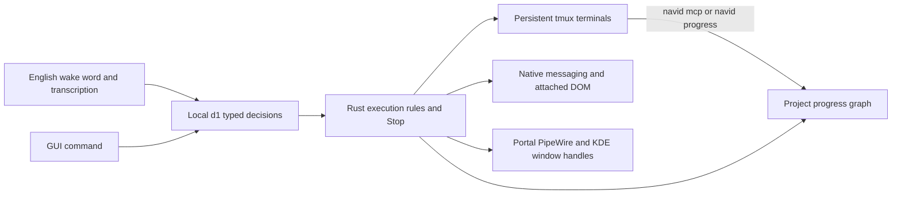

# Navi Station

Local orchestration around installed terminal harnesses, using the original Copland
Three.js interface. Rust owns decisions, settings, sessions and action execution.
Codex, Claude Code, Pi and custom profiles keep their native terminal behavior.
The initial display host is Python/GTK3/WebKit2GTK 4.1, not Tauri. tmux preserves
harness processes when the window or Rust service closes.



Leading wake words and fillers ("Hey Navi.", "okay Navi,", "um", "uh", "well,", "so", "go ahead and") are dropped
before a request is read. Decisions select registered identifiers. Model output never supplies executable
commands, paths, selectors or desktop scripts. Requests must explicitly name their
target. Supported requests start with an action verb, optionally preceded by
“please”, “can you”, “could you” or “let's” (“fire up”, “spin up” and “boot up” launch too). Negated, deferred, explanatory and ambiguous
requests cannot automatically select an execution target.

Examples: `Open Codex`, `Launch Claude Code in Navi`, `Open a terminal called Review`,
`Switch to Review`, `Open GitHub` (a configured favorite), `Switch to <tab title>`,
`Click <attached button name>`, `Focus <unique app name> window` (KDE and a connected
desktop). Up to four steps can be separated by ` then `; ` and ` also separates steps
when every half is a command Navi answers itself (`open codex and show the progress`).

Progress requests never need a model: `How far along is the project?`,
`Show the progress`, `Assess the project`, `Set the UI to 80%`,
`Mark barge-in done`, `Reopen barge-in`. See [Project progress](#project-progress).
Neither do session requests: `Is Codex done?`, `What's running?`, `Stop Codex`,
`Close terminal 2`, `Reopen Codex`, `Tell Codex to run the tests` (held until a busy
pane is free), `Ask Claude to fix the build` (opens Claude Code first when it is
closed), `/help`. When Navi asks "Which one?", the next command can be just the answer
("the second one"). The same commands run from a shell with `navid ask "…"`.

Every harness Navi opens is linked to the progress graph. The model reads the
recorded completion and reports its own estimate per part through Navi's MCP server, or
through the `navid progress` CLI for Pi. Running `navid link` prints the one-time setup
for a harness started outside Navi. Commits made after the latest estimate are counted
on screen and in spoken answers, and a reassessment hands the model the last numbers
and those commit subjects.

## Install without starting the desktop

Linux prerequisites: Cargo, tmux, curl, Python with GTK3/WebKit2GTK 4.1,
GStreamer/PipeWire and the desktop portal. Speech uses Python 3.12 and PortAudio.
Tested on Fedora 44/KDE Wayland, Linux x86_64.

From the repository root:

```bash
npm ci --ignore-scripts
npm ci --ignore-scripts --prefix apps/navi
node apps/navi/scripts/bundle.mjs
uv venv --python 3.12 --system-site-packages ~/.local/share/navi/venv
uv pip install --python ~/.local/share/navi/venv/bin/python -r apps/navi/requirements.txt
python3 apps/navi/scripts/download-models.py
python3 apps/navi/scripts/download-assets.py
python3 apps/navi/scripts/install.py --no-start
```

Downloads use pinned revisions and SHA-256 checksums. Decision weights and projection
total about 2.26 GB. Wake detection uses the small Zipformer keyword spotter; local
fallback STT is Whistle or Moonshine. Optional backups:
`download-assets.py --only moonshine whisper`. Model licenses are separate from
application code; consult their model cards before redistribution.

Hex is the preferred local transcriber when installed. Navi uses its one-shot CLI
(`hex model transcribe <wav>`), not the Hex desktop listener, so Navi keeps owning
the microphone and wake word. Install Hex separately and fetch its model:

```bash
hex model install    # Parakeet Unified English, ~731 MB
hex model check      # verifies the compute device and model
```

Without Hex the voice pipeline still works through the cloud hops and the local
sherpa recognizer. Model licenses are separate from application code.

When ready, run `~/.local/bin/navi-station` or open **Navi Station** from the launcher.
The microphone starts disabled. “Navi” (or “Hey Navi”) commits an English utterance to
the same chief. Voice is experimental. Stop interrupts pending inference and undelivered
actions; it cannot undo an action already dispatched. Uncertain actions are never retried.

Voice reads 100 ms mono blocks at 16 kHz. A three-second pre-roll preserves the wake
phrase while the detector catches up; a command ends after 900 ms of silence or at
the 20-second buffer limit. After the wake, Navi waits up to 6 seconds for speech to
begin, so a natural pause before the request does not end the command. Silence with
no request is discarded instead of being sent to the assistant. Overflow discards
the entire partial command and requires another wake. Whistle receives at most 24
registered names, prioritizing the active session. Transcripts completed after mic
disable or speech replacement are discarded. One chief request can be pending; new
commands are discarded while busy and recognized Stop bypasses that request.

Settings expose the model endpoint, executable, weights, projection, GPU layers,
CPU threads, profiles, projects, favorites and speech configuration. Replacement
decision providers must implement the typed `/v1/systemone` contract; ordinary chat
endpoints need an adapter. Changing execution configuration cancels pending decisions.
Speech engines are `whistle`, `moonshine` or `whisper`, with configurable weights/folders.

## Voice assistant

The window's main surface is the 3D stage with one chat panel at the bottom.
A message there is a record, not a line of text — `{id,turn,role,time,status,parts,meta}`
with text, reasoning, tool, diff and error parts — so a streamed answer grows in one
row and is finalised in place, a tool call collapses into one chip per call id that is
upserted to a single final state, reasoning stays folded away, and a failed turn keeps
its row with Retry. A gated tool's chip carries Allow and Deny; a decision
(`permission_reply`) the daemon refuses stays pending and shows the daemon's own
sentence as the one failure row, never as a decision. Answers render markdown (fenced
and inline code with copy buttons, lists, bold, and http links as copyable text) from
DOM nodes only; model output is never parsed as HTML. Each row offers copy, retry,
edit-and-resend, its timestamp and, when the daemon reports them, the answering model,
token count and cost. The paperclip attaches up to four files (2 MiB each, images or
text) that travel base64 with the prompt; an oversized file is refused before sending
and an unreadable one can be removed from its chip. The last 200 messages for the project are saved (`message_save`)
and rehydrated (`messages`) on boot; scrolling to the top asks for the page before the
oldest loaded cursor (`messages {limit,before}`) and stops when the store answers
`has_more:false`, so a page can never repeat or skip a row even when timestamps
collide. Only the rows around the viewport are mounted. The log autoscrolls only when
the reader is following it: following stops only when the reader scrolls away from
the bottom (a toast or banner resizing the log does not count) and resumes when they
scroll back, press the "jump to latest" pill, or send a message.

The status chip is a projection of the poll payload (`Ready`, `Working`, `Attention`,
`Host not responding`), beside a short model name with an inline switcher and a
plain-word voice pill; one failure produces one row, never a permanent alarm. A failed
row keeps its failed state and its Retry across restarts, and when OpenCode is missing it
says so in plain words and lists the Navi commands that still work without it. A first
run shows an empty-state block with one-click Open <harness> (the first installed
harness), Assess progress, New session, Settings and Enable mic, and the mic button
explains why it is unavailable. Typing `/` opens a filtered list that starts with
Navi's own commands (`/progress`, `/assess`, `/open`, `/mark`, `/set`), which never
reach the assistant, followed by the OpenCode slash commands (arrows/Tab to complete); a
Stop button appears while a request runs and
cancels it, reporting when the server did not confirm the interrupt. A session strip at
the top-left shows the active project's live sessions as chips and collapses the rest
into "Elsewhere (N)" (live sessions of other projects, named with their project and
flagged when one needs input) and "Recent (N)" (finished sessions). A chip shows the
harness profile name, its state (a colored dot: running, idle, busy, needs input) and
last activity, numbers duplicate names within a project ("Codex #2"), drops the state
word rather than wrapping when the strip is crowded, and is reconciled in place; clicking one attaches an xterm terminal pane to its live tmux
session, titled like its chip (`Terminal #2 · Navi`: session, harness when the name
does not already say it, project), where an inline prompt field sends input straight
into the harness. Clicking a finished chip reopens it (`session_restart`): same name,
the harness's own conversation when one was recorded, and the old chip leaves Recent.
When the attached session ends, the pane title adds "exited", the prompt field and
Stop are disabled, and Send becomes Reopen. The "+" chip opens a quick-launch menu: one click starts Codex,
Claude Code, Pi, OpenCode, a terminal or a custom profile in the active project and
attaches it; a harness whose binary is not on the launch PATH, or whose profile names
a full path that is not an executable file (`harness_list` reports these as
`missing_paths`), is listed as "not installed" and cannot be picked. "More options…" opens the full launcher dialog — any
registered profile (the first installed harness preselected), a project directory, and
an optional first prompt that is injected once the harness is up. The settings gear
also edits harness profiles (name, command, arguments written as shell words, so
`--flag 'two words'` stays one argument and round-trips exactly; a JSON list is also
accepted), outlines commands that are not on the launch PATH, and offers a searchable
model picker grouped by provider that can never save an empty reference. The
terminal's Stop sends `session_interrupt` to the attached harness.

Microphone capture is off by default. The station's Mic button saves the
`microphone` setting and calls `voice_start`; turning it off releases the input
device. While a transcript is being confirmed the chat panel shows it with its
source and provider confidence, puts it in the composer and counts the confirm
window down: Enter first claims the held transcript from the daemon
(`voice_confirm {accept:true}`) and sends it only when the claim is won, so when the
worker's deadline already sent it the UI says "already sent" and nothing runs twice;
Escape withdraws the hold (`voice_confirm {accept:false}`) and turns it into an
editable draft, and Use accepts it. The voice pill reports the worker in plain words
(Mic off, Listening, Waiting, Transcribing, Confirming) and the status line states the
speech language set in Settings, together with the wake word's English-only
limitation. Capture prefers
a PipeWire input and otherwise falls back to the system
default input, so a machine without a device literally named "pipewire" still
records.

`navid serve` starts the voice worker with the daemon, so an enabled microphone
listens in `background` mode with no window open. Saying "Navi", or "Hey Navi",
opens the Station window and keeps capturing, so the command that follows needs no
second wake word. An open window is never required and a closed one is opened once
per wake, with a 10 s cooldown so repeated wakes cannot spawn several windows. The
`navi` launcher opens the window on demand:

```bash
navi          # opens the Station window, starting navid if needed
navi-pi       # the older Copland-themed Pi window (pi-navi-theme)
```

Flow: 16 kHz mono audio -> local sherpa KWS ("Navi" / "Hey Navi") -> wait for
speech to start (up to 6 s) -> endpoint after 900 ms of silence -> STT -> the same
Rust chief as typed commands -> OpenCode gateway -> `reply_delta` events while the
answer streams, then `reply` -> optional `speech_out`. Wake detection always stays
local.

STT prefers a configured remote provider first (Deepgram -> Groq -> Cloudflare ->
Gemini); a remote answer avoids spawning a local model per utterance. Add
`DEEPGRAM_API_KEY` to `~/.config/navi/secrets.env` to enable Deepgram Nova-3
(free tier, raw-WAV POST). Groq now requests `whisper-large-v3`. When the cloud
hops are missing, disabled (`speech_mode` is `local-only` or `cloud-only`), or
return nothing, the utterance falls back to Hex — the preferred local
transcriber when installed — and then the configured local engine (whistle,
moonshine or whisper). With no keys the cloud check returns before audio
conversion or upload, so it adds no latency.

The 3.3M keyword spotter hears "navigation" and "navigate" as the same phonetic
prefix as "Navi". Those transcripts are discarded before dispatch, so a false wake
cannot run a command; a genuine utterance is unaffected.

If a reply is playing, saying "Navi" cancels playback (barge-in). Command capture is
muted during playback except for the wake detector, so Navi does not transcribe its
own TTS output; after the interruption the rest of the command is captured without
another wake word.

When a spoken reply ends in a question ("Which one: Codex #1, Codex #2?"), Navi listens
for the answer without the wake word: capture starts once the 0.6 s echo window after
playback has passed and ends as no command if nobody speaks within 6 s.

### OpenCode client

Navi is a real OpenCode client, not a one-shot chat bridge. `workers/opencode_gateway.py`
talks to the running `opencode serve` HTTP API and exposes:

- prompts that stream assistant text deltas over SSE while keeping the final reply
  authoritative in the message store;
- slash commands (`/help`, `/init`, `/review`, plugin commands) through OpenCode's
  command endpoint, with `/help` listing the live catalog without a model turn
  (pressing `/` outside a text field focuses the command box and opens the menu, and
  ArrowUp in an empty box recalls this project's earlier commands);
- the model and agent catalog, used by the settings selectors;
- session reuse (`~/.local/share/navi/opencode-session`), rotation, and interrupt;
- automatic `opencode serve` startup when the service is unreachable, unless
  `NAVI_OPENCODE_AUTOSPAWN=0`.

The editable system prompt is the OpenCode agent file
`~/.config/opencode/agents/navi.md`. Saving settings rewrites that file, and OpenCode
hot-reloads it, so the next turn uses the edit. New sessions select the `navi` agent
and the configured model. Defaults are agent `navi` and model
`commandcode/deepseek/deepseek-v4.1-flash`; both are chosen in settings.

### Status feed

The daemon coalesces the live answer: text deltas are accumulated per turn and published
as one `reply_delta` every 120 ms (or 240 characters) carrying `{turn, text, done:false}`
— the text of the whole turn so far, so a client replaces rather than appends. The
authoritative row is `status.turn_state` (`{turn,text,done}`), always present together
with `busy`; `done` clears the client even if the terminal `reply` event was missed.
Terminal events (`reply`, `error`) are retained outside the 100-event diagnostic ring, so
a burst of deltas cannot evict the answer.

`status` also returns `boot_id`, `events_from` and `has_more`. Sequence numbers are opaque
across boots: a restarted daemon changes `boot_id`, and a cursor below `events_from` is
unrecoverable, so the client resets and re-snapshots. A truncated page sets `has_more`
and the client drains the next page immediately.

Every command carries a `request_id`, either the client's own or one the daemon assigns,
from its RPC reply through each event it causes: `working`, deltas, tool calls, one
`reply` with every step's answer joined, and on failure an `error` that also names the
failing `op`. The station keys the command's chat row by that id. The RPC answer and
the live feed race, and either can arrive first; with one key they land on one row
instead of two. Errors from other callers (a harness's `navid progress`, a panel edit)
never fail the open turn. The feed replays retained events from the start on every
boot. Finished turns come back from the message store, so replayed turn events do not
draw them again; only the turn the daemon still reports as running is rebuilt from the
feed.

`status` accepts `sections` and `versions`: only the requested sections are computed, and
a section whose content hash matches the caller's version is omitted (`versions` is always
returned). An event-only poll is `{"since": n, "sections": []}`. Without `sections` the
payload is the full snapshot every existing caller expects. `tmux list-panes` and the
visible tail of each session are cached for one second and shared by all status callers,
so an idle poll never forks per session.

The GTK host drives the feed itself: it polls `status` at 40 ms while a turn is open and
at 700 ms when idle, and hands every changed payload to the page through `navi.push`.
The first page after a load is the full snapshot; later pages are event-only, and an
unchanged page is not delivered at all. `NAVI_PUSH=0` disables the host feed, and
`NAVI_PUSH_LOG=1` logs one stderr line per push decision. Push counters are reported in
the QA JSON under `host.push` and printed once when the window closes. The page keeps
`connect-src 'none'`; push reuses the existing `window.webkit.messageHandlers.navi`
bridge.

### Project progress

Navi keeps one completion record per project: a headline percent, a percent per
*part* (an area of the project such as "Voice" or "Station UI"; `aspects` in the
schema), and an optional task checklist under each part. Nothing stores a percentage:
`graph_get {project_id}` recomputes every number from the append-only `signals`
ledger, and every signal must carry non-empty evidence.

#### How the percent is computed

A model's judgment ("the UI is about 60% done") and hard evidence (a passing test, a
ticked box) both describe progress, and neither is enough alone: a new project has no
tasks, so task arithmetic shows nothing, and a model that can never be overruled is
not a measurement. So both count, and the newer one wins:

- **Part.** The newest `estimate` stated for the part (by a harness, the detector,
  Navi's assistant or the user). If *verified* task evidence is newer — a user
  verdict, a test result, a commit, a checkpoint — the part is the weighted mean of its
  tasks instead. A part with tasks and no estimate is always the task mean. A model
  ticking one task does not overrule its own estimate of the part.
- **Headline.** Whichever is newer: the latest whole-project estimate, or the weighted
  mean of the parts. A part with no value of its own borrows the whole-project
  estimate.
- **Task.** A user verdict is final (done 100%, in progress 50%, otherwise 0).
  Otherwise the newest signal decides: an estimate's value, a test or commit result,
  or a legacy `assistant_claim` at half its confidence, halved again after 7 days.
- **Unknown** is `null` and renders as `—`, never 0 or 100.
- **verified** is the share of task weight whose deciding signal is a verdict, test,
  commit or checkpoint from a non-assistant source. **confidence** is the deciding
  estimate's confidence faded by a 10-day half-life (task-only projects keep
  coverage × freshness).
- **risks** name what is weak: no parts, a headline estimate older than 7 days, parts
  with no evidence for 14 days, tasks with no evidence, unassigned or blocked tasks,
  and commits made after the headline was set. **commits_since** carries that count;
  the HUD shows it beside "Progress", the project switcher shows that project's
  percent in amber, and spoken answers end with it, so a number
  the latest work has not reached reads as such until a reassessment.

A short trace:

```text
Claude Code: Voice 60% ("wake word and STT wired, barge-in untested")  → Voice 60%, basis estimate
User ticks "Barge-in" done (verdict, newer)                             → Voice 25% (1 of 4 tasks), basis tasks
Claude Code: Voice 70% again                                             → Voice 70%, basis estimate
Claude Code: whole project 66%                                           → headline 66%, basis estimate
User: "set the station UI to 70%" (a part, newer than the headline)     → headline = weighted mean of parts
```

The payload is `{project, percent, percent_null, verified, confidence, as_of, why,
basis{kind: estimate|parts|none, source, time}, estimate, trend[{time, percent,
source}], aspects[], unassigned[], tasks{total, todo, in_progress, done, blocked,
dropped}, risks[], commits_since, signals[], signal_count}`. Each part carries `percent`,
`percent_null`, `basis` (`estimate`, `tasks` or `none`), its `estimate`, the `derived`
task mean, `verified`, `confidence` and its task `items[]`. The newest 40 signals (working-tree clean/dirty flips collapsed to the current one)
travel with the payload, so every number can be explained by the rows behind it.
`progress_overview` returns the headline of every project for the switcher.

#### Harness link

Every pane Navi launches carries `NAVI_PROJECT_ID`, `NAVI_SESSION_ID`, `NAVI_HARNESS`,
`NAVI_BIN`, `NAVI_DATA_DIR` and `NAVI_RUNTIME_DIR`, and `navid`'s directory is
appended to its `PATH`. Each harness is registered at launch on its command line, so
no user config file is touched:

| Harness | Registration |
| --- | --- |
| Claude Code | `--mcp-config` with a `navi` stdio server (`navid mcp`), `--allowedTools` for its three tools, `--append-system-prompt` with the instructions |
| Codex | `-c mcp_servers.navi.command/args/env` overrides |
| OpenCode | a `mcp.navi` local server merged into `OPENCODE_CONFIG_CONTENT` |
| Pi | `--append-system-prompt` telling it to run `navid progress` from its shell tool |

A profile opts out with `"link": false`. `navid mcp` speaks newline-delimited JSON-RPC
2.0 over stdio (MCP 2024-11-05 through 2025-11-25) and offers three tools:

- `navi_progress` reads the record: headline and basis, each part, the task checklist,
  and the subjects of up to five commits that landed after the basis estimate.
- `navi_report_progress {percent, part?, evidence, confidence?}` states how complete
  the whole project (no `part`) or one part is. A new part name creates the part.
- `navi_track_task {task, state, part?, evidence, percent?}` adds a task or moves it
  between `todo`, `in_progress`, `done` and `blocked`; tasks match by title.

Each tool also takes an optional `project` (name or id) for work outside the project's
folder. Outside every registered folder, the error lists the known projects.

Harnesses without MCP use the CLI, which reaches the same daemon call:

```bash
navid progress
navid progress report 60 "settings dialog renders; save path untested" --part "Station UI"
navid progress task done "Barge-in" "test_voice_policy passes" --part Voice
```

The project is the pane's session project, else the registered project containing the
working directory, else the only project; `--project` overrides it. A report moves the
number at once and adds one feed row ("Claude Code put Voice at 60% — evidence").

A harness started outside Navi has none of this until its own config names the server.
`navid link [claude|codex|opencode|pi]` prints that one-time setup with this binary's
absolute path and the harness name in `NAVI_HARNESS`: a `claude mcp add` command, a
`[mcp_servers.navi]` table for `~/.codex/config.toml`, an `mcp.navi` block for
`opencode.json`, and the CLI instructions for Pi's `AGENTS.md`. Settings shows the same
text under "Link a harness you start yourself", with a Copy button (daemon op
`link_setup`). Navi prints the setup and never edits those files. A binary replaced while the
daemon runs (an upgrade or rebuild) is named by its original path, not Linux's
`navid (deleted)`, both here and in pane launches. Started anywhere inside a registered project folder, the harness
then reports to that project, because the daemon resolves the project from the
working directory.

#### Project detector

`project_detect {project_id, via?}` runs from the Assess button, `/assess`, or "assess
the project":

1. **Scan.** A bounded walk (at most 8000 entries, depth 8, 700 text files of up to
   256 KiB) counts languages, test files, TODO/FIXME and stub markers, markdown
   checklists, CI and git history, and proposes parts (workspace members or top-level
   code directories). `project_scan` returns the scan alone.
2. **Seed.** If no model has estimated the project yet and its checklists hold at
   least 5 items, the checked share is recorded as a detector estimate with
   confidence 0.35. A model's estimate always replaces it.
3. **Assess.** If a linked harness (Claude Code, Codex, OpenCode or Pi) is running in
   the project and is not busy, Navi types an assessment request into it — the known
   parts (or "choose 3 to 7"), the scan facts, and how to report — and each estimate
   lands as the harness reports it. A reassessment also names the last estimate per
   part and up to 8 commit subjects since it (from the HEAD the probes saw then), so
   the model updates the numbers where the work changed instead of starting over. With none, or with `via:"assistant"`, Navi's own
   assistant reads the project in the background and answers with lines of the form
   `PROGRESS part "<part>" <percent> | <evidence>` and `PROGRESS overall <percent> |
   <evidence>`, recorded as estimates with confidence 0.6. Both routes also ask for up
   to three remaining tasks per unfinished part (`navi_track_task`, `navid progress
   task todo`, or `TASK "<part>" todo "<task>" | <why>` lines). These tasks feed
   "what's left" but never move a part that an estimate leads. A part whose tasks are
   all still open shows no task-derived marker. When that assistant cannot
   answer either (the gateway's `status` finds no OpenCode server and no `opencode`
   CLI to start one), Navi opens the first launch profile whose harness reports through
   the link and is installed, in the project, with the assessment request as its first
   prompt (`via:"launch"`), and the harness reports as above. With nothing installed
   the request fails with a message that names what to install.

The HUD reads "Assessing…" and a comet circles the ring until reports arrive.

#### Voice and typed commands

These run on the deterministic fast path, so they work without the local decision
model and without the assistant:

| Say or type | Effect |
| --- | --- |
| "How far along is the project?", "where are we at", "status update", "what's left", "what's the progress", `/progress` | Speaks the headline, its basis and the part furthest behind; naming one part ("how far is the voice part", "how's the daemon coming along") answers for that part, naming one task ("is barge-in done?") gives its state and part, "what's left" (or "what's next") lists every unfinished part and up to five open tasks, and "what changed today" (or "any progress today") sums up the last day: the newest estimate per part, task updates, and commits with the latest one's subject. The headline answer ends with how many commits landed since the last estimate, and "is the estimate up to date" (or "commits since the estimate") answers that directly, zero included. "Show …" (or "show me the graph", "show the progress graph") also opens the panel |
| "Close the progress", "hide the graph" | Closes the progress panel |
| "Assess the project", "reassess acme-api", "reassess", "rescan the project", "update the estimate", `/assess` | Runs the detector |
| "Set the UI to 80%", "put voice at 60 percent", "bump the UI to 75", "the project is at 70%", `/set voice to 80%` | Records a user estimate for that part, or for the whole project |
| "Mark barge-in done", "check off barge-in", "reopen barge-in", "barge-in is done", "we finished barge-in", `/mark barge-in in progress` | Sets a task's state as a user verdict (a statement counts only when a task or part by that name exists, so "the build is done" stays conversation); with no matching task, "mark <part> done" puts the part at 100% |
| "Open Codex", `/open claude code` | Brings forward the Codex already open in the active project, else launches one; "open a new Codex" (or "… called X") always launches |
| "Switch to acme-api", "go to acme-api", "take me to Codex", "show Codex", "open the acme-api project" | Makes that project active in the station (a session with that name wins) and speaks its headline. The reply is stored with the question, in the project it was asked in, and shows as a notice after the switch |
| "Tell Codex to run the tests", "ask Claude what it changed", "have Codex run the tests", "Codex #2, run the tests", "terminal: ls", "say hello to Codex", "type ls in the terminal", "continue in Codex: add a test", "tell this to …" | Types the prompt into that open session ("this" is the active one), as the voice route does; a terminal gets the command itself ("tell terminal to run ls" types `ls`). The prompt keeps its casing; a session busy with a command is not typed over: Navi holds the prompt and types it once the pane is free (up to ten minutes; Stop cancels), with a chat row when it is sent. When no session by that name is open but it names a harness ("ask Claude to fix the build" with Claude closed), Navi opens that harness in the active project and sends the prompt once it is ready ("say … to" and "type … in" only reach open sessions) |
| "Stop Codex", "interrupt terminal number two", "close terminal #2", "quit Claude Code" | Interrupts (stop, interrupt, pause) or closes (close, quit, exit, kill, end) that one session. The words after the verb must name a single open session, so "stop opening Codex" is not read this way. With two candidates, a session in the active project wins, otherwise Navi asks which, naming the project when the names match ("Which one: Codex in Navi, Codex in acme-api?"); "close Codex in acme-api" answers it. A closed session stays under Recent |
| "The second one", "Codex #2", "acme-api", "last" | Answers a "Which one" question from the last minute (for stop, close, switch, a prompt, or a task name that matched several tasks) and runs the original command on that session. In the chat the choices are buttons on the question until it is answered, another command runs, or the minute passes. Any other command drops the question |
| "Which project am I in", "list projects" | Names the active project and every project with its percent |
| "Reopen Codex", "resume terminal", "reopen Codex #2" | Reopens a finished session from Recent (newest first, this project first) under its old name; a harness that recorded its conversation id continues that conversation. Clicking a finished chip does the same. When nothing finished matches but that session is open, Navi says so; otherwise the words go on to "reopen <task>" |
| "Help", "what can you do", `/help` | Lists what Navi answers without a model |
| "Thanks", "never mind", "cancel", "forget it" | A short acknowledgement, without waking the assistant |
| "Navi?", "hello", "um" | Only a wake word, greeting or filler: Navi asks what you need (spoken, so the answer needs no wake word) |
| "Open settings", "add a project" | Opens that dialog in the station window |
| "Is Codex done?", "what is Claude doing", "what's running", "is anything busy", `/sessions`, "does anything need my input" | Answers from the panes' state (working, waiting for your input, running a command, idle, starting), named as the session strip names them; "is Pi open" with no Pi says it is not open |

Steps chain with "then" (or "and" when every half is one of these commands), at most
four: "switch to acme-api then assess the project" assesses acme-api, because a step
that switches project rescopes the steps after it.

Task names match loosely ("barge in" finds "Barge-in"); an ambiguous name lists the
candidates instead of guessing. With **Speak replies** on, the voice worker speaks the
reply.

The same commands work from a shell, for scripts and hotkeys. `navid ask` scopes them to
the pane's project, else the registered project holding the working directory, and
prints the reply; it does not change the project voice defaults to:

```bash
navid ask "how far along are we"
navid ask "tell codex to run the tests"
```

#### On screen

- The **ring** around the emblem fills to the headline percent. An unknown percent
  leaves only the faint track (unknown is not zero), and a comet circles the track
  while an assessment runs.
- The **progress HUD** beside the session strip shows the percent, a bar and its basis
  ("Estimate by Claude Code · 2h ago", "Across 4 parts"), plus an Assess button.
  Clicking it opens the panel; Escape closes it.
- The **project switcher** shows each project's headline percent.
- The **progress panel** (the "Progress" pill) shows the headline, confidence, the
  task count with its verified share (left out when there are no tasks) and a trend line of whole-project estimates; each part's bar marks the
  task-derived value when an estimate leads. A part expands to its basis, evidence and
  task checklist: ticking a box records a user verdict, and parts, tasks and percents
  can be added or set in place. Risks, unassigned tasks, the last scan and an evidence
  drawer (kind, source, signal id, time, evidence text) follow.
- **Feed rows**: each harness report is one compact row with its evidence; the user's
  own changes add no row, and rows replayed from history at startup are not narrated
  again.

The panel has its own cell in the L0 grid: a 320–380 px right rail above 1280 px, a drawer
over the stage cell at 900–1279 px, and a tab in the composer area below 900 px, where the
panel owns the stage cell.

### Harness evidence

`harness_tail {id, lines?, task_id?}` captures the pane (`capture-pane -p -J -S -N`),
stores one `session_tails` row per distinct screen — keyed by an FNV-1a content hash, so
the sampler reading the same pane for 90 s writes one row and at most one signal — and
reads the newest decisive test line with the profile family's versioned rules (revision 1:
`PASSED 12`, `12 passed`, `FAILED 3`, `3 failed`, `test result: ok. 12 passed; 0 failed`).
The matching line is the signal's evidence and its source is `harness`, which counts as
verified. A failure count outranks a pass on the same line; a zero failure count is not a
failure; anything ambiguous emits nothing.

A task is bound by the explicit `task_id` or by a `navi:task=<id>` trailer in the output.
A `test_fail` line for a bound task sets the task to `blocked`; no other output changes a
task's state. After each prompt the daemon samples the prompted session once at 5 s and
then every 10 s for 90 s; `NAVI_TAIL_SAMPLE_MS` compresses all three for tests.

### Project scope

The active project is window state (`localStorage["navi.project"]`), not a setting, and an
event's `project_id` never moves it. The strip's switcher shows the name and path state and
lists every registered project; clicking one, or pressing Ctrl+1..9, changes what "this
project" means in one step: the new-session dialog's default directory, the graph request,
the assistant session, the re-hydrated transcript, and the status line. `assistant_scope
{project_id}` resolves the project's directory and reports the session that project already
owns; every turn carries the project, so the gateway reuses that directory's own session,
while a turn that is already running keeps its binding for interrupt and permission
replies. A session launched in another project makes that project active.

Typed commands carry the active project. Voice commands carry none, so the daemon keeps
the project the station last reported (on load, on each switch, with each typed command,
and on a spoken "switch to …") and falls back to the project of the voice-targeted
session. Naming a project in the command ("how far is acme-api") still wins. Spoken
conversation that reaches the assistant uses the same project.

"Add project…" at the end of the switcher menu (or the switcher itself, while there is
no project) opens a dialog: a folder, typed or picked with the window's native folder
chooser (the host's `pick-folder` message), a name that follows the folder's name until
edited, and "Assess its progress now", which runs the detector on the new project as
soon as `project_add {name, path}` registers it and the switcher moves to it.

### Speech output

Spoken replies are off by default. The settings gear's **Speak replies** toggle stores
the `speak` key; when it is false the voice worker never starts `speech_out` and no
TTS provider is contacted. When enabled, TTS tries edge-tts -> Cloudflare -> Gemini ->
Piper, and barge-in cancels playback as described above.

A harness that starts waiting for input is announced once, on the transition. The
station shows a notice ("Codex is waiting for your input") unless that pane is the one
on screen. With **Speak replies** on, the voice worker also says it, unless Navi is
already speaking. Sessions already waiting when Navi starts are not announced.

The single `navi` persona in `config/personas.json` (overridable from
`~/.config/navi/personas.toml`) only supplies the edge voice, Piper fallback and
rate. The system prompt lives in the OpenCode agent file described above.

`tts.py` maps the persona edge voice to a Piper model id, so a cloud failure still
gets a valid local voice. Piper looks in `~/.local/share/navi/models/piper`
(`NAVI_PIPER_MODELS` overrides the folder).

Provider tuning lives in `~/.config/navi/speech.json`:

```json
{
  "speech_mode": "cloud-first",
  "tts_order": ["edge", "cloudflare", "gemini", "piper"],
  "stt_order": ["groq", "cloudflare", "gemini"],
  "disabled": [],
  "timeout_seconds": 3.0
}
```

`speech_mode` is `cloud-first` (default), `local-only` (skip every cloud STT/TTS
hop) or `cloud-only` (never use local TTS/STT fallbacks). Credentials go in
`~/.config/navi/secrets.env`; process environment wins:

```bash
GROQ_API_KEY=...
CLOUDFLARE_ACCOUNT_ID=...
CLOUDFLARE_API_TOKEN=...
GEMINI_API_KEY=...
```

Cloud STT/TTS tests use local mock servers. The end-to-end test synthesizes
"Navi" plus a question with Piper, drives wake detection, endpointing, STT and
the command RPC against an isolated daemon whose decision fixture routes the
question to the live OpenCode service on `127.0.0.1:49374`, then synthesizes the
reply to `/tmp/navi-e2e-reply.<fmt>` without playback. It never restarts that
service. The test disables the Hex hop (`NAVI_HEX_DISABLE=1`) so its STT
assertions are deterministic; `test_hex_asr.py` covers the Hex CLI and its
opt-in live check.

```bash
CARGO_TARGET_DIR=/tmp/navi-cargo-target cargo build --locked --manifest-path apps/navi/Cargo.toml -j 2
cargo test --locked --manifest-path apps/navi/Cargo.toml
~/.local/share/navi/venv/bin/python apps/navi/scripts/test_cloud_stt.py
~/.local/share/navi/venv/bin/python apps/navi/scripts/test_tts.py
~/.local/share/navi/venv/bin/python apps/navi/scripts/test_persona.py
~/.local/share/navi/venv/bin/python apps/navi/scripts/test_voice_policy.py
~/.local/share/navi/venv/bin/python apps/navi/scripts/test_voice_stream.py
~/.local/share/navi/venv/bin/python apps/navi/scripts/test_voice_headless.py
~/.local/share/navi/venv/bin/python apps/navi/scripts/test_hex_asr.py
~/.local/share/navi/venv/bin/python apps/navi/scripts/test_station.py
~/.local/share/navi/venv/bin/python apps/navi/scripts/test_opencode_gateway.py
~/.local/share/navi/venv/bin/python apps/navi/scripts/test_e2e_voice.py
~/.local/share/navi/venv/bin/python apps/navi/scripts/smoke_opencode.py
~/.local/share/navi/venv/bin/python apps/navi/scripts/smoke_tts.py
python3 apps/navi/scripts/test_capture_pipeline.py
```

## Desktop and browser

Desktop starts only from the `desktop_start` RPC and portal consent; the chat-only
window has no desktop control. PipeWire frames are reduced
to two fps before scaling/conversion to CPU JPEG. One 768-pixel-wide frame is retained.
Capture never triggers model inference itself. The 3D scene runs at most 30 fps and
suspends rendering when hidden.

Desktop actions use accessible controls, bounded keys/scroll and native KDE window
identifiers. Arbitrary screenshot-to-coordinate automation is not implemented.
The image projection is installed for subsequent visual decisions; ordinary routing
uses text questions and registered targets.

The installed native messaging host connects the extension to private Rust IPC.
In Zen, load `browser/manifest.json` through `about:debugging` → This Firefox → Load
Temporary Add-on. Open its popup on a regular web page and attach that page. The
permission request covers that origin; the adapter controls only the attached tab.
Navigation/detachment revokes the grant. Temporary installation ends at browser restart;
permanent distribution requires a signed Firefox add-on.

Browser observations exclude secret, hidden and editable content and remove URL
queries/fragments. Unchanged pages retain element identity across polls so slow CPU
inference can finish. Targets are checked again before execution and after focus handlers.

## Isolated validation

Tests create disposable state, terminal sockets, profiles and model endpoints.
`NAVI_ISOLATED=1` requires explicit private data/runtime directories, blocks audio and
desktop workers, and rejects browser launches and desktop input. GUI tests use Xvfb,
private D-Bus and software WebGL. Browser tests use headless Firefox and a disposable
profile with a test-only localhost permission grant. They do not use the running Zen
profile, desktop, clipboard or microphone. Model checks use two CPU threads, no GPU
offload and reduced process priority.

```bash
CARGO_TARGET_DIR=/tmp/navi-cargo-target cargo build --locked --manifest-path apps/navi/Cargo.toml -j 2
python3 apps/navi/scripts/test_station.py
python3 apps/navi/scripts/test_assistant.py
python3 apps/navi/scripts/test_streaming.py
python3 apps/navi/scripts/test_harness.py
python3 apps/navi/scripts/test_graph.py
python3 apps/navi/scripts/test_voice_policy.py
python3 apps/navi/scripts/test_voice_stream.py
python3 apps/navi/scripts/test_capture_pipeline.py
python3 apps/navi/scripts/test_gui_isolated.py
python3 apps/navi/scripts/test_gui_isolated.py --workflow
python3 apps/navi/scripts/test_gui_isolated.py --layout
python3 apps/navi/scripts/test_gui_isolated.py --chat
python3 apps/navi/scripts/test_gui_isolated.py --reliability
python3 apps/navi/scripts/test_gui_isolated.py --crash
python3 apps/navi/scripts/test_gui_isolated.py --fallback
python3 apps/navi/scripts/test_browser_live.py --geckodriver /path/to/geckodriver --real-model
python3 apps/navi/scripts/evaluate_chief.py --held-out
~/.local/share/navi/venv/bin/python apps/navi/scripts/test_voice_workflow.py --piper-dir /path/to/vits-piper-en_US-amy-low
node_modules/.bin/tsgo --noEmit -p apps/navi/tsconfig.json
CARGO_TARGET_DIR=/tmp/navi-cargo-target cargo clippy --locked --manifest-path apps/navi/Cargo.toml --all-targets -- -D warnings
npm run check
```

The `--held-out` command now repeats the expanded 32-case regression, since its initial
findings refined validation. Result: 32/32; this is not population accuracy. Initial
failures and the rejected intent-question experiment are preserved in `evidence/`.
Earlier GPU timings belong to an earlier revision. CPU and workflow results are separate.

Synthetic speech tests support Whistle for harness names. They do not establish
microphone, accent or noisy-room reliability. `voice-workflow.json` now uses the same
production capture buffer with deterministic Piper audio in 100 ms chunks. Launch,
switch, one Stop phrasing and absence of a wake word were verified; another short Stop
phrasing missed its wake word and remains a recorded failure. `voice-stream-initial.json`
preserves failures found during refinement. Buffer and dispatch tests cover overflow,
silence, the duration limit, busy commands, cancellation and settings changes.

`gui-workflow.json` records interaction with the real 3D GUI: provider/speech settings,
invalid endpoint rejection, named harness launch, session selection, commands and Stop.
That GUI check uses a deterministic decision fixture and private shell profiles.
The separate speech workflow uses real d1 on CPU. Isolated mode also blocks the GUI's
external desktop launcher. GUI closure preserved all three test terminal processes.

Live microphone streaming, the revised
pipeline with the actual portal, and final window focus behavior remain pending while
desktop testing is paused. All scoped test reports are in `evidence/`.

Sources: [LiquidAI d1](https://huggingface.co/LiquidAI/d1-3B),
[decision weights](https://huggingface.co/LiquidAI/d1-3B-GGUF),
[Hex](https://anoma.ly/hex/),
[Whistle](https://huggingface.co/Cactus-Compute/whistle),
[Sherpa wake detector](https://k2-fsa.github.io/sherpa/onnx/kws/pretrained_models/index.html),
[Piper test voice](https://k2-fsa.github.io/sherpa/onnx/tts/all/English/vits-piper-en_US-amy-low.html),
[desktop portal](https://flatpak.github.io/xdg-desktop-portal/docs/doc-org.freedesktop.portal.RemoteDesktop.html),
[KWin API](https://develop.kde.org/docs/plasma/kwin/api/),
[Firefox automation](https://firefox-source-docs.mozilla.org/testing/geckodriver/Usage.html).
