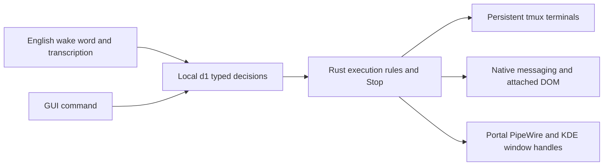

# Navi Station

Local orchestration around installed terminal harnesses, using the original Copland
Three.js interface. Rust owns decisions, settings, sessions and action execution.
Codex, Claude Code, Pi and custom profiles keep their native terminal behavior.
The initial display host is Python/GTK3/WebKit2GTK 4.1, not Tauri. tmux preserves
harness processes when the window or Rust service closes.



Decisions select registered identifiers. Model output never supplies executable
commands, paths, selectors or desktop scripts. Requests must explicitly name their
target. Supported requests start with an action verb, optionally preceded by
“please”, “can you” or “could you”. Negated, deferred, explanatory and ambiguous
requests cannot automatically select an execution target.

Examples: `Open Codex`, `Launch Claude Code in Navi`, `Open a terminal called Review`,
`Switch to Review`, `Open GitHub` (a configured favorite), `Switch to <tab title>`,
`Click <attached button name>`, `Focus <unique app name> window` (KDE and a connected
desktop). Up to four steps can be separated by ` then `.

## Install without starting the desktop

Linux prerequisites: Cargo, tmux, curl, Python with GTK3/WebKit2GTK 4.1,
GStreamer/PipeWire and the desktop portal. Speech uses Python 3.12 and PortAudio.
Tested on Fedora 44/KDE Wayland, Linux x86_64.

From the repository root:

```bash
npm ci --ignore-scripts
npm ci --ignore-scripts --prefix apps/navi
node apps/navi/scripts/bundle.mjs
uv venv --python 3.12 --system-site-packages ~/.local/share/navi/venv
uv pip install --python ~/.local/share/navi/venv/bin/python -r apps/navi/requirements.txt
python3 apps/navi/scripts/download-models.py
python3 apps/navi/scripts/download-assets.py
python3 apps/navi/scripts/install.py --no-start
```

Downloads use pinned revisions and SHA-256 checksums. Decision weights and projection
total about 2.26 GB. Wake detection uses the small Zipformer keyword spotter; local
fallback STT is Whistle or Moonshine. Optional backups:
`download-assets.py --only moonshine whisper`. Model licenses are separate from
application code; consult their model cards before redistribution.

Hex is the preferred local transcriber when installed. Navi uses its one-shot CLI
(`hex model transcribe <wav>`), not the Hex desktop listener, so Navi keeps owning
the microphone and wake word. Install Hex separately and fetch its model:

```bash
hex model install    # Parakeet Unified English, ~731 MB
hex model check      # verifies the compute device and model
```

Without Hex the voice pipeline still works through the cloud hops and the local
sherpa recognizer. Model licenses are separate from application code.

When ready, run `~/.local/bin/navi-station` or open **Navi Station** from the launcher.
The microphone starts disabled. “Navi” (or “Hey Navi”) commits an English utterance to
the same chief. Voice is experimental. Stop interrupts pending inference and undelivered
actions; it cannot undo an action already dispatched. Uncertain actions are never retried.

Voice reads 100 ms mono blocks at 16 kHz. A three-second pre-roll preserves the wake
phrase while the detector catches up; a command ends after 900 ms of silence or at
the 20-second buffer limit. After the wake, Navi waits up to 6 seconds for speech to
begin, so a natural pause before the request does not end the command. Silence with
no request is discarded instead of being sent to the assistant. Overflow discards
the entire partial command and requires another wake. Whistle receives at most 24
registered names, prioritizing the active session. Transcripts completed after mic
disable or speech replacement are discarded. One chief request can be pending; new
commands are discarded while busy and recognized Stop bypasses that request.

Settings expose the model endpoint, executable, weights, projection, GPU layers,
CPU threads, profiles, projects, favorites and speech configuration. Replacement
decision providers must implement the typed `/v1/systemone` contract; ordinary chat
endpoints need an adapter. Changing execution configuration cancels pending decisions.
Speech engines are `whistle`, `moonshine` or `whisper`, with configurable weights/folders.

## Voice assistant

The window's main surface is the 3D stage with one chat panel at the bottom.
A message there is a record, not a line of text — `{id,turn,role,time,status,parts,meta}`
with text, reasoning, tool, diff and error parts — so a streamed answer grows in one
row and is finalised in place, a tool call collapses into one chip per call id that is
upserted to a single final state, reasoning stays folded away, and a failed turn keeps
its row with Retry. A gated tool's chip carries Allow and Deny; a decision
(`permission_reply`) the daemon refuses stays pending and shows the daemon's own
sentence as the one failure row, never as a decision. Answers render markdown (fenced
and inline code with copy buttons, lists, bold, and http links as copyable text) from
DOM nodes only; model output is never parsed as HTML. Each row offers copy, retry,
edit-and-resend, its timestamp and, when the daemon reports them, the answering model,
token count and cost. The paperclip attaches up to four files (2 MiB each, images or
text) that travel base64 with the prompt; an oversized file is refused before sending
and an unreadable one can be removed from its chip. The last 200 messages for the project are saved (`message_save`)
and rehydrated (`messages`) on boot; scrolling to the top asks for the page before the
oldest loaded cursor (`messages {limit,before}`) and stops when the store answers
`has_more:false`, so a page can never repeat or skip a row even when timestamps
collide. Only the rows around the viewport are mounted. The log autoscrolls only when
the reader is already at the bottom and otherwise offers a "jump to latest" pill.

The status chip is a projection of the poll payload (`Ready`, `Working`, `Attention`,
`Host not responding`), beside a short model name with an inline switcher and a
plain-word voice pill; one failure produces one row, never a permanent alarm. A first
run shows an empty-state block with New session, Settings and Enable mic, and the mic
button explains why it is unavailable. Typing `/` opens a filtered list of OpenCode
slash commands (arrows/Tab to complete); a Stop button appears while a request runs and
cancels it, reporting when the server did not confirm the interrupt. A session strip at
the top-left separates live sessions from a collapsed Recent list, shows the harness
profile name, its state and last activity, disambiguates duplicate names and reconciles
its chips in place; clicking one attaches an xterm terminal pane to its live tmux
session, where an inline prompt field sends input straight into the harness. The "+"
chip opens a launcher dialog — pick any registered harness profile (Codex, Claude Code,
Pi, or a custom one added in Settings), a project directory, and an optional first
prompt that is injected once the harness is up. The settings gear also edits harness
profiles (name, executable, args as a JSON array, so a value containing spaces stays
one argument) and offers a searchable model picker grouped by provider that can never
save an empty reference. The terminal's Stop sends `session_interrupt` to the attached
harness.

Microphone capture is off by default. The station's Mic button saves the
`microphone` setting and calls `voice_start`; turning it off releases the input
device. While a transcript is being confirmed the chat panel shows it with its
source and provider confidence, puts it in the composer and counts the confirm
window down: Enter first claims the held transcript from the daemon
(`voice_confirm {accept:true}`) and sends it only when the claim is won, so when the
worker's deadline already sent it the UI says "already sent" and nothing runs twice;
Escape withdraws the hold (`voice_confirm {accept:false}`) and turns it into an
editable draft, and Use accepts it. The voice pill reports the worker in plain words
(Mic off, Listening, Waiting, Transcribing, Confirming) and the status line states the
speech language set in Settings, together with the wake word's English-only
limitation. Capture prefers
a PipeWire input and otherwise falls back to the system
default input, so a machine without a device literally named "pipewire" still
records.

`navid serve` starts the voice worker with the daemon, so an enabled microphone
listens in `background` mode with no window open. Saying "Navi", or "Hey Navi",
opens the Station window and keeps capturing, so the command that follows needs no
second wake word. An open window is never required and a closed one is opened once
per wake, with a 10 s cooldown so repeated wakes cannot spawn several windows. The
`navi` launcher opens the window on demand:

```bash
navi          # opens the Station window, starting navid if needed
navi-pi       # the older Copland-themed Pi window (pi-navi-theme)
```

Flow: 16 kHz mono audio -> local sherpa KWS ("Navi" / "Hey Navi") -> wait for
speech to start (up to 6 s) -> endpoint after 900 ms of silence -> STT -> the same
Rust chief as typed commands -> OpenCode gateway -> `reply_delta` events while the
answer streams, then `reply` -> optional `speech_out`. Wake detection always stays
local.

STT prefers a configured remote provider first (Deepgram -> Groq -> Cloudflare ->
Gemini); a remote answer avoids spawning a local model per utterance. Add
`DEEPGRAM_API_KEY` to `~/.config/navi/secrets.env` to enable Deepgram Nova-3
(free tier, raw-WAV POST). Groq now requests `whisper-large-v3`. When the cloud
hops are missing, disabled (`speech_mode` is `local-only` or `cloud-only`), or
return nothing, the utterance falls back to Hex — the preferred local
transcriber when installed — and then the configured local engine (whistle,
moonshine or whisper). With no keys the cloud check returns before audio
conversion or upload, so it adds no latency.

The 3.3M keyword spotter hears "navigation" and "navigate" as the same phonetic
prefix as "Navi". Those transcripts are discarded before dispatch, so a false wake
cannot run a command; a genuine utterance is unaffected.

If a reply is playing, saying "Navi" cancels playback (barge-in). Command capture is
muted during playback except for the wake detector, so Navi does not transcribe its
own TTS output; after the interruption the rest of the command is captured without
another wake word.

### OpenCode client

Navi is a real OpenCode client, not a one-shot chat bridge. `workers/opencode_gateway.py`
talks to the running `opencode serve` HTTP API and exposes:

- prompts that stream assistant text deltas over SSE while keeping the final reply
  authoritative in the message store;
- slash commands (`/help`, `/init`, `/review`, plugin commands) through OpenCode's
  command endpoint, with `/help` listing the live catalog without a model turn;
- the model and agent catalog, used by the settings selectors;
- session reuse (`~/.local/share/navi/opencode-session`), rotation, and interrupt;
- automatic `opencode serve` startup when the service is unreachable, unless
  `NAVI_OPENCODE_AUTOSPAWN=0`.

The editable system prompt is the OpenCode agent file
`~/.config/opencode/agents/navi.md`. Saving settings rewrites that file, and OpenCode
hot-reloads it, so the next turn uses the edit. New sessions select the `navi` agent
and the configured model. Defaults are agent `navi` and model
`commandcode/deepseek/deepseek-v4.1-flash`; both are chosen in settings.

### Status feed

The daemon coalesces the live answer: text deltas are accumulated per turn and published
as one `reply_delta` every 120 ms (or 240 characters) carrying `{turn, text, done:false}`
— the text of the whole turn so far, so a client replaces rather than appends. The
authoritative row is `status.turn_state` (`{turn,text,done}`), always present together
with `busy`; `done` clears the client even if the terminal `reply` event was missed.
Terminal events (`reply`, `error`) are retained outside the 100-event diagnostic ring, so
a burst of deltas cannot evict the answer.

`status` also returns `boot_id`, `events_from` and `has_more`. Sequence numbers are opaque
across boots: a restarted daemon changes `boot_id`, and a cursor below `events_from` is
unrecoverable, so the client resets and re-snapshots. A truncated page sets `has_more`
and the client drains the next page immediately.

`status` accepts `sections` and `versions`: only the requested sections are computed, and
a section whose content hash matches the caller's version is omitted (`versions` is always
returned). An event-only poll is `{"since": n, "sections": []}`. Without `sections` the
payload is the full snapshot every existing caller expects. `tmux list-panes` and the
visible tail of each session are cached for one second and shared by all status callers,
so an idle poll never forks per session.

The GTK host drives the feed itself: it polls `status` at 40 ms while a turn is open and
at 700 ms when idle, and hands every changed payload to the page through `navi.push`.
The first page after a load is the full snapshot; later pages are event-only, and an
unchanged page is not delivered at all. `NAVI_PUSH=0` disables the host feed, and
`NAVI_PUSH_LOG=1` logs one stderr line per push decision. Push counters are reported in
the QA JSON under `host.push` and printed once when the window closes. The page keeps
`connect-src 'none'`; push reuses the existing `window.webkit.messageHandlers.navi`
bridge.

### Project graph

Completion is derived, never stored. `graph_get {project_id}` recomputes from the
append-only `signals` ledger and returns `{project, percent, percent_null, verified,
confidence, aspects[], tasks, risks[], as_of, signals[], signal_count, why}`. Each aspect
carries its own `percent`/`percent_null`, `verified`, task count and how many tasks have
no evidence. The newest 40 signals travel with the payload, so every number can be
explained by the rows behind it. A signal requires non-empty `evidence`; assistant claims
are capped and decay, and only a user verdict is terminal.

Unknown is an em dash, never 0 or 100. The panel renders `—` when the project has no
aspects *and* when no aspect has an evidence-backed task, and the same rule applies per
aspect bar. The empty state names the gap ("No aspects defined") and offers one action:
add an aspect. Below the headline sit `verified`, `confidence`, the aspect bars, risks, an
evidence drawer (kind, source, signal id, time, the evidence text), and the `as of` stamp.

The panel has its own cell in the L0 grid: a 320–380 px right rail above 1280 px, a drawer
over the stage cell at 900–1279 px, and a tab in the composer area below 900 px, where the
panel owns the stage cell. Every measurement of the real GUI at 1440×920, 1280×720 and
960×640 reports zero panel intersections.

### Harness evidence

`harness_tail {id, lines?, task_id?}` captures the pane (`capture-pane -p -J -S -N`),
stores one `session_tails` row per distinct screen — keyed by an FNV-1a content hash, so
the sampler reading the same pane for 90 s writes one row and at most one signal — and
reads the newest decisive test line with the profile family's versioned rules (revision 1:
`PASSED 12`, `12 passed`, `FAILED 3`, `3 failed`, `test result: ok. 12 passed; 0 failed`).
The matching line is the signal's evidence and its source is `harness`, which counts as
verified. A failure count outranks a pass on the same line; a zero failure count is not a
failure; anything ambiguous emits nothing.

A task is bound by the explicit `task_id` or by a `navi:task=<id>` trailer in the output.
A `test_fail` line for a bound task sets the task to `blocked`; no other output changes a
task's state. After each prompt the daemon samples the prompted session once at 5 s and
then every 10 s for 90 s; `NAVI_TAIL_SAMPLE_MS` compresses all three for tests.

### Project scope

The active project is window state (`localStorage["navi.project"]`), not a setting, and an
event's `project_id` never moves it. The strip's switcher shows the name and path state and
lists every registered project; clicking one, or pressing Ctrl+1..9, changes what "this
project" means in one step: the new-session dialog's default directory, the graph request,
the assistant session, the re-hydrated transcript, and the status line. `assistant_scope
{project_id}` resolves the project's directory and reports the session that project already
owns; every turn carries the project, so the gateway reuses that directory's own session,
while a turn that is already running keeps its binding for interrupt and permission
replies. A session launched in another project makes that project active.

### Speech output

Spoken replies are off by default. The settings gear's **Speak replies** toggle stores
the `speak` key; when it is false the voice worker never starts `speech_out` and no
TTS provider is contacted. When enabled, TTS tries edge-tts -> Cloudflare -> Gemini ->
Piper, and barge-in cancels playback as described above.

The single `navi` persona in `config/personas.json` (overridable from
`~/.config/navi/personas.toml`) only supplies the edge voice, Piper fallback and
rate. The system prompt lives in the OpenCode agent file described above.

`tts.py` maps the persona edge voice to a Piper model id, so a cloud failure still
gets a valid local voice. Piper looks in `~/.local/share/navi/models/piper`
(`NAVI_PIPER_MODELS` overrides the folder).

Provider tuning lives in `~/.config/navi/speech.json`:

```json
{
  "speech_mode": "cloud-first",
  "tts_order": ["edge", "cloudflare", "gemini", "piper"],
  "stt_order": ["groq", "cloudflare", "gemini"],
  "disabled": [],
  "timeout_seconds": 3.0
}
```

`speech_mode` is `cloud-first` (default), `local-only` (skip every cloud STT/TTS
hop) or `cloud-only` (never use local TTS/STT fallbacks). Credentials go in
`~/.config/navi/secrets.env`; process environment wins:

```bash
GROQ_API_KEY=...
CLOUDFLARE_ACCOUNT_ID=...
CLOUDFLARE_API_TOKEN=...
GEMINI_API_KEY=...
```

Cloud STT/TTS tests use local mock servers. The end-to-end test synthesizes
"Navi" plus a question with Piper, drives wake detection, endpointing, STT and
the command RPC against an isolated daemon whose decision fixture routes the
question to the live OpenCode service on `127.0.0.1:49374`, then synthesizes the
reply to `/tmp/navi-e2e-reply.<fmt>` without playback. It never restarts that
service. The test disables the Hex hop (`NAVI_HEX_DISABLE=1`) so its STT
assertions are deterministic; `test_hex_asr.py` covers the Hex CLI and its
opt-in live check.

```bash
CARGO_TARGET_DIR=/tmp/navi-cargo-target cargo build --locked --manifest-path apps/navi/Cargo.toml -j 2
cargo test --locked --manifest-path apps/navi/Cargo.toml
~/.local/share/navi/venv/bin/python apps/navi/scripts/test_cloud_stt.py
~/.local/share/navi/venv/bin/python apps/navi/scripts/test_tts.py
~/.local/share/navi/venv/bin/python apps/navi/scripts/test_persona.py
~/.local/share/navi/venv/bin/python apps/navi/scripts/test_voice_policy.py
~/.local/share/navi/venv/bin/python apps/navi/scripts/test_voice_stream.py
~/.local/share/navi/venv/bin/python apps/navi/scripts/test_voice_headless.py
~/.local/share/navi/venv/bin/python apps/navi/scripts/test_hex_asr.py
~/.local/share/navi/venv/bin/python apps/navi/scripts/test_station.py
~/.local/share/navi/venv/bin/python apps/navi/scripts/test_opencode_gateway.py
~/.local/share/navi/venv/bin/python apps/navi/scripts/test_e2e_voice.py
~/.local/share/navi/venv/bin/python apps/navi/scripts/smoke_opencode.py
~/.local/share/navi/venv/bin/python apps/navi/scripts/smoke_tts.py
python3 apps/navi/scripts/test_capture_pipeline.py
```

## Desktop and browser

Desktop starts only from the `desktop_start` RPC and portal consent; the chat-only
window has no desktop control. PipeWire frames are reduced
to two fps before scaling/conversion to CPU JPEG. One 768-pixel-wide frame is retained.
Capture never triggers model inference itself. The 3D scene runs at most 30 fps and
suspends rendering when hidden.

Desktop actions use accessible controls, bounded keys/scroll and native KDE window
identifiers. Arbitrary screenshot-to-coordinate automation is not implemented.
The image projection is installed for subsequent visual decisions; ordinary routing
uses text questions and registered targets.

The installed native messaging host connects the extension to private Rust IPC.
In Zen, load `browser/manifest.json` through `about:debugging` → This Firefox → Load
Temporary Add-on. Open its popup on a regular web page and attach that page. The
permission request covers that origin; the adapter controls only the attached tab.
Navigation/detachment revokes the grant. Temporary installation ends at browser restart;
permanent distribution requires a signed Firefox add-on.

Browser observations exclude secret, hidden and editable content and remove URL
queries/fragments. Unchanged pages retain element identity across polls so slow CPU
inference can finish. Targets are checked again before execution and after focus handlers.

## Isolated validation

Tests create disposable state, terminal sockets, profiles and model endpoints.
`NAVI_ISOLATED=1` requires explicit private data/runtime directories, blocks audio and
desktop workers, and rejects browser launches and desktop input. GUI tests use Xvfb,
private D-Bus and software WebGL. Browser tests use headless Firefox and a disposable
profile with a test-only localhost permission grant. They do not use the running Zen
profile, desktop, clipboard or microphone. Model checks use two CPU threads, no GPU
offload and reduced process priority.

```bash
CARGO_TARGET_DIR=/tmp/navi-cargo-target cargo build --locked --manifest-path apps/navi/Cargo.toml -j 2
python3 apps/navi/scripts/test_station.py
python3 apps/navi/scripts/test_assistant.py
python3 apps/navi/scripts/test_streaming.py
python3 apps/navi/scripts/test_harness.py
python3 apps/navi/scripts/test_graph.py
python3 apps/navi/scripts/test_voice_policy.py
python3 apps/navi/scripts/test_voice_stream.py
python3 apps/navi/scripts/test_capture_pipeline.py
python3 apps/navi/scripts/test_gui_isolated.py
python3 apps/navi/scripts/test_gui_isolated.py --workflow
python3 apps/navi/scripts/test_gui_isolated.py --layout
python3 apps/navi/scripts/test_gui_isolated.py --chat
python3 apps/navi/scripts/test_gui_isolated.py --reliability
python3 apps/navi/scripts/test_gui_isolated.py --crash
python3 apps/navi/scripts/test_gui_isolated.py --fallback
python3 apps/navi/scripts/test_browser_live.py --geckodriver /path/to/geckodriver --real-model
python3 apps/navi/scripts/evaluate_chief.py --held-out
~/.local/share/navi/venv/bin/python apps/navi/scripts/test_voice_workflow.py --piper-dir /path/to/vits-piper-en_US-amy-low
node_modules/.bin/tsgo --noEmit -p apps/navi/tsconfig.json
CARGO_TARGET_DIR=/tmp/navi-cargo-target cargo clippy --locked --manifest-path apps/navi/Cargo.toml --all-targets -- -D warnings
npm run check
```

The `--held-out` command now repeats the expanded 32-case regression, since its initial
findings refined validation. Result: 32/32; this is not population accuracy. Initial
failures and the rejected intent-question experiment are preserved in `evidence/`.
Earlier GPU timings belong to an earlier revision. CPU and workflow results are separate.

Synthetic speech tests support Whistle for harness names. They do not establish
microphone, accent or noisy-room reliability. `voice-workflow.json` now uses the same
production capture buffer with deterministic Piper audio in 100 ms chunks. Launch,
switch, one Stop phrasing and absence of a wake word were verified; another short Stop
phrasing missed its wake word and remains a recorded failure. `voice-stream-initial.json`
preserves failures found during refinement. Buffer and dispatch tests cover overflow,
silence, the duration limit, busy commands, cancellation and settings changes.

`gui-workflow.json` records interaction with the real 3D GUI: provider/speech settings,
invalid endpoint rejection, named harness launch, session selection, commands and Stop.
That GUI check uses a deterministic decision fixture and private shell profiles.
The separate speech workflow uses real d1 on CPU. Isolated mode also blocks the GUI's
external desktop launcher. GUI closure preserved all three test terminal processes.

Live microphone streaming, the revised
pipeline with the actual portal, and final window focus behavior remain pending while
desktop testing is paused. All scoped test reports are in `evidence/`.

Sources: [LiquidAI d1](https://huggingface.co/LiquidAI/d1-3B),
[decision weights](https://huggingface.co/LiquidAI/d1-3B-GGUF),
[Hex](https://anoma.ly/hex/),
[Whistle](https://huggingface.co/Cactus-Compute/whistle),
[Sherpa wake detector](https://k2-fsa.github.io/sherpa/onnx/kws/pretrained_models/index.html),
[Piper test voice](https://k2-fsa.github.io/sherpa/onnx/tts/all/English/vits-piper-en_US-amy-low.html),
[desktop portal](https://flatpak.github.io/xdg-desktop-portal/docs/doc-org.freedesktop.portal.RemoteDesktop.html),
[KWin API](https://develop.kde.org/docs/plasma/kwin/api/),
[Firefox automation](https://firefox-source-docs.mozilla.org/testing/geckodriver/Usage.html).
