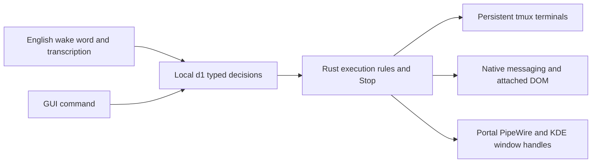

# Navi Station

Local orchestration around installed terminal harnesses, using the original Copland
Three.js interface. Rust owns decisions, settings, sessions and action execution.
Codex, Claude Code, Pi and custom profiles keep their native terminal behavior.
The initial display host is Python/GTK3/WebKit2GTK 4.1, not Tauri. tmux preserves
harness processes when the window or Rust service closes.



Decisions select registered identifiers. Model output never supplies executable
commands, paths, selectors or desktop scripts. Requests must explicitly name their
target. Supported requests start with an action verb, optionally preceded by
“please”, “can you” or “could you”. Negated, deferred, explanatory and ambiguous
requests cannot automatically select an execution target.

Examples: `Open Codex`, `Launch Claude Code in Navi`, `Open a terminal called Review`,
`Switch to Review`, `Open GitHub` (a configured favorite), `Switch to <tab title>`,
`Click <attached button name>`, `Focus <unique app name> window` (KDE and a connected
desktop). Up to four steps can be separated by ` then `.

## Install without starting the desktop

Linux prerequisites: Cargo, tmux, curl, Python with GTK3/WebKit2GTK 4.1,
GStreamer/PipeWire and the desktop portal. Speech uses Python 3.12 and PortAudio.
Tested on Fedora 44/KDE Wayland, Linux x86_64.

From the repository root:

```bash
npm ci --ignore-scripts
npm ci --ignore-scripts --prefix apps/navi
node apps/navi/scripts/bundle.mjs
uv venv --python 3.12 --system-site-packages ~/.local/share/navi/venv
uv pip install --python ~/.local/share/navi/venv/bin/python -r apps/navi/requirements.txt
python3 apps/navi/scripts/download-models.py
python3 apps/navi/scripts/download-assets.py
python3 apps/navi/scripts/install.py --no-start
```

Downloads use pinned revisions and SHA-256 checksums. Decision weights and projection
total about 2.26 GB. Default speech is Whistle plus the small Zipformer wake detector.
Optional backups: `download-assets.py --only moonshine whisper`. Model licenses are
separate from application code; consult their model cards before redistribution.

When ready, run `~/.local/bin/navi-station` or open **Navi Station** from the launcher.
The microphone starts disabled. “Hey Navi” commits an English utterance to the same
chief. Voice is experimental. Stop interrupts pending inference and undelivered
actions; it cannot undo an action already dispatched. Uncertain actions are never retried.

Voice reads 100 ms mono blocks at 16 kHz. A three-second pre-roll preserves the wake
phrase while the detector catches up; a command ends after 900 ms of silence or at
the 20-second buffer limit. Float32 audio uses at most 192 KB for pre-roll and 1.28 MB
for a recording, excluding transcription copies and model memory. Overflow discards
the entire partial command and requires another wake. Whistle receives at most 24
registered names, prioritizing the active session. Transcripts completed after mic
disable or speech replacement are discarded. One chief request can be pending; new
commands are discarded while busy and recognized Stop bypasses that request.

Settings expose the model endpoint, executable, weights, projection, GPU layers,
CPU threads, profiles, projects, favorites and speech configuration. Replacement
decision providers must implement the typed `/v1/systemone` contract; ordinary chat
endpoints need an adapter. Changing execution configuration cancels pending decisions.
Speech engines are `whistle`, `moonshine` or `whisper`, with configurable weights/folders.

## Voice assistant

Microphone capture is off by default. The station's Mic button saves the
`microphone` setting and calls `voice_start`; turning it off releases the input
device. Capture prefers a PipeWire input and otherwise falls back to the system
default input, so a machine without a device literally named "pipewire" still
records.

Flow: 16 kHz mono audio -> local sherpa KWS ("Hey Navi") -> endpoint after 900 ms
of silence -> STT -> the same Rust chief as typed commands -> OpenCode bridge (with
the active persona prompt) -> `reply` event to the UI + `speech_out` -> TTS
(edge-tts -> Cloudflare -> Gemini -> Piper). Wake detection always stays local.
When `speech_mode` is not `local-only` and a cloud STT key exists, the utterance
tries Groq -> Cloudflare -> Gemini first and falls back to the configured local
engine (whistle, moonshine or whisper) when every cloud hop returns no text. With
no keys the cloud check returns before audio conversion or upload, so it adds no
latency.

If a reply is playing, saying "Hey Navi" cancels playback (barge-in). Command
capture is muted during playback except for the wake detector, so Navi does not
transcribe its own TTS output; after the interruption the rest of the command is
captured without another wake word.

Personas are loaded from `config/personas.json`, overridden by
`~/.config/navi/personas.toml`. Each defines a system prompt, an edge voice and a
rate. Switch from the settings dialog or by voice: "switch to friendly mode",
"be concise", "use jarvis persona". Defaults:

| Persona | Edge voice | Piper fallback |
| --- | --- | --- |
| jarvis | en-GB-RyanNeural | en_GB-alan-medium |
| friendly | en-US-AriaNeural | en_GB-alan-medium |
| concise | en-US-GuyNeural | en_GB-alan-medium |

`tts.py` maps the persona edge voice to a Piper model id, so a cloud failure
still gets a valid local voice. Piper looks in
`~/.local/share/navi/models/piper` (`NAVI_PIPER_MODELS` overrides the folder).

Provider tuning lives in `~/.config/navi/speech.json`:

```json
{
  "speech_mode": "cloud-first",
  "tts_order": ["edge", "cloudflare", "gemini", "piper"],
  "stt_order": ["groq", "cloudflare", "gemini"],
  "disabled": [],
  "timeout_seconds": 3.0
}
```

`speech_mode` is `cloud-first` (default), `local-only` (skip every cloud STT/TTS
hop) or `cloud-only` (never use local TTS/STT fallbacks). Credentials go in
`~/.config/navi/secrets.env`; process environment wins:

```bash
GROQ_API_KEY=...
CLOUDFLARE_ACCOUNT_ID=...
CLOUDFLARE_API_TOKEN=...
GEMINI_API_KEY=...
```

Cloud STT/TTS tests use local mock servers. The end-to-end test synthesizes
"Hey Navi" plus a question with Piper, drives wake detection, endpointing, STT and
the command RPC against an isolated daemon whose decision fixture routes the
question to the live OpenCode service on `127.0.0.1:49374`, then synthesizes the
reply to `/tmp/navi-e2e-reply.<fmt>` without playback. It never restarts that
service.

```bash
CARGO_TARGET_DIR=/tmp/navi-cargo-target cargo build --locked --manifest-path apps/navi/Cargo.toml -j 2
cargo test --locked --manifest-path apps/navi/Cargo.toml
~/.local/share/navi/venv/bin/python apps/navi/scripts/test_cloud_stt.py
~/.local/share/navi/venv/bin/python apps/navi/scripts/test_tts.py
~/.local/share/navi/venv/bin/python apps/navi/scripts/test_persona.py
~/.local/share/navi/venv/bin/python apps/navi/scripts/test_voice_policy.py
~/.local/share/navi/venv/bin/python apps/navi/scripts/test_voice_stream.py
~/.local/share/navi/venv/bin/python apps/navi/scripts/test_station.py
~/.local/share/navi/venv/bin/python apps/navi/scripts/test_e2e_voice.py
~/.local/share/navi/venv/bin/python apps/navi/scripts/test_opencode_bridge.py
~/.local/share/navi/venv/bin/python apps/navi/scripts/smoke_opencode.py
~/.local/share/navi/venv/bin/python apps/navi/scripts/smoke_tts.py
python3 apps/navi/scripts/test_capture_pipeline.py
```

## Desktop and browser

Desktop starts only from its button and portal consent. PipeWire frames are reduced
to two fps before scaling/conversion to CPU JPEG. One 768-pixel-wide frame is retained.
Capture never triggers model inference itself. The 3D scene runs at most 30 fps and
suspends rendering when hidden.

Desktop actions use accessible controls, bounded keys/scroll and native KDE window
identifiers. Arbitrary screenshot-to-coordinate automation is not implemented.
The image projection is installed for subsequent visual decisions; ordinary routing
uses text questions and registered targets.

The installed native messaging host connects the extension to private Rust IPC.
In Zen, load `browser/manifest.json` through `about:debugging` → This Firefox → Load
Temporary Add-on. Open its popup on a regular web page and attach that page. The
permission request covers that origin; the adapter controls only the attached tab.
Navigation/detachment revokes the grant. Temporary installation ends at browser restart;
permanent distribution requires a signed Firefox add-on.

Browser observations exclude secret, hidden and editable content and remove URL
queries/fragments. Unchanged pages retain element identity across polls so slow CPU
inference can finish. Targets are checked again before execution and after focus handlers.

## Isolated validation

Tests create disposable state, terminal sockets, profiles and model endpoints.
`NAVI_ISOLATED=1` requires explicit private data/runtime directories, blocks audio and
desktop workers, and rejects browser launches and desktop input. GUI tests use Xvfb,
private D-Bus and software WebGL. Browser tests use headless Firefox and a disposable
profile with a test-only localhost permission grant. They do not use the running Zen
profile, desktop, clipboard or microphone. Model checks use two CPU threads, no GPU
offload and reduced process priority.

```bash
CARGO_TARGET_DIR=/tmp/navi-cargo-target cargo build --locked --manifest-path apps/navi/Cargo.toml -j 2
python3 apps/navi/scripts/test_station.py
python3 apps/navi/scripts/test_voice_policy.py
python3 apps/navi/scripts/test_voice_stream.py
python3 apps/navi/scripts/test_capture_pipeline.py
python3 apps/navi/scripts/test_gui_isolated.py
python3 apps/navi/scripts/test_gui_isolated.py --workflow
python3 apps/navi/scripts/test_browser_live.py --geckodriver /path/to/geckodriver --real-model
python3 apps/navi/scripts/evaluate_chief.py --held-out
~/.local/share/navi/venv/bin/python apps/navi/scripts/test_voice_workflow.py --piper-dir /path/to/vits-piper-en_US-amy-low
node_modules/.bin/tsgo --noEmit -p apps/navi/tsconfig.json
CARGO_TARGET_DIR=/tmp/navi-cargo-target cargo clippy --locked --manifest-path apps/navi/Cargo.toml --all-targets -- -D warnings
npm run check
```

The `--held-out` command now repeats the expanded 32-case regression, since its initial
findings refined validation. Result: 32/32; this is not population accuracy. Initial
failures and the rejected intent-question experiment are preserved in `evidence/`.
Earlier GPU timings belong to an earlier revision. CPU and workflow results are separate.

Synthetic speech tests support Whistle for harness names. They do not establish
microphone, accent or noisy-room reliability. `voice-workflow.json` now uses the same
production capture buffer with deterministic Piper audio in 100 ms chunks. Launch,
switch, one Stop phrasing and absence of a wake word were verified; another short Stop
phrasing missed its wake word and remains a recorded failure. `voice-stream-initial.json`
preserves failures found during refinement. Buffer and dispatch tests cover overflow,
silence, the duration limit, busy commands, cancellation and settings changes.

`gui-workflow.json` records interaction with the real 3D GUI: provider/speech settings,
invalid endpoint rejection, named harness launch, session selection, commands and Stop.
That GUI check uses a deterministic decision fixture and private shell profiles.
The separate speech workflow uses real d1 on CPU. Isolated mode also blocks the GUI's
external desktop launcher. GUI closure preserved all three test terminal processes.

Live microphone streaming, the revised
pipeline with the actual portal, and final window focus behavior remain pending while
desktop testing is paused. All scoped test reports are in `evidence/`.

Sources: [LiquidAI d1](https://huggingface.co/LiquidAI/d1-3B),
[decision weights](https://huggingface.co/LiquidAI/d1-3B-GGUF),
[Whistle](https://huggingface.co/Cactus-Compute/whistle),
[Sherpa wake detector](https://k2-fsa.github.io/sherpa/onnx/kws/pretrained_models/index.html),
[Piper test voice](https://k2-fsa.github.io/sherpa/onnx/tts/all/English/vits-piper-en_US-amy-low.html),
[desktop portal](https://flatpak.github.io/xdg-desktop-portal/docs/doc-org.freedesktop.portal.RemoteDesktop.html),
[KWin API](https://develop.kde.org/docs/plasma/kwin/api/),
[Firefox automation](https://firefox-source-docs.mozilla.org/testing/geckodriver/Usage.html).
