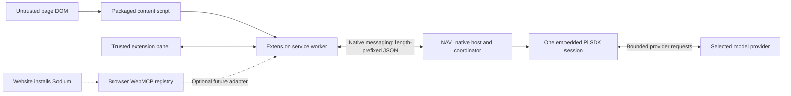

# NAVI architecture and implementation contract

> Current CLI/extension foundation: [architecture](../navi-foundation/architecture.md) and [developer setup](../../packages/navi/README.md). Its CLI-owned harness and relay-only native host supersede this older browser-spawned embedded-agent placement. The research and reference validation below remain historical evidence, not a statement of current runtime behavior.

**Revised 2026-09-13. This is the authoritative design.** NAVI is not an implemented application yet. This repository contains the design and executable checks of selected integration contracts. Passing those checks does not establish browser compatibility, answer quality, or release readiness.

The [previous architecture](research/archive-2026-09-11-architecture.md) and original research reports are historical evidence. Where they disagree with this document, use this document. The [implementation review](research/11-implementation-review.md) records the corrections and Sodium evidence.

## 1. Product decision

Build a browser assistant that helps a person understand the page or selection they deliberately share. Its first useful result is an answer supported by identifiable passages on that page, without copy/paste. NAVI's ambient identity can begin with a quiet summon button; it does not require background capture or unsolicited model calls.

The first release has three user operations:

1. **Ask about this page.** Summon NAVI, inspect the captured excerpt and destination provider, ask a question, and receive an answer with source-block references.
2. **Explain this selection.** Include selected text and enough surrounding context to explain it. If extraction is incomplete, say what is missing.
3. **Ask a follow-up.** Continue against the explicitly identified captured page. A new page requires a new capture; an old answer never silently becomes an answer about the active tab.

Use Pi only if its tool-based follow-ups provide a measured benefit over the same UI, extraction and model with one direct model call. Both variants keep credentials in the local host. Pi is a replaceable reasoning dependency, not the product's justification.

| Capability | Decision | User benefit and admission condition |
| --- | --- | --- |
| Page/selection answers with passage references | First release | Primary task; measure correctness and time saved |
| Bounded `navi_page` reads from a captured snapshot | First release | Find omitted evidence without sending the whole page |
| Cancel, progress, capture preview, clear session | First release | Control what is shared and when work ends |
| Compare two deliberately captured pages | Next candidate | Must improve comparison tasks; no tab-history capture |
| Explicit pins, search and delete | Next candidate | Require demonstrated recall need; no database before then |
| Sodium/WebMCP tool consumption | Early experiment; later opt-in execution | Structured site operations may reduce UI guessing; require supported API, useful sites and comparison tests |
| Source verification across websites | Later, independent of memory | Needs search/fetch, bounded egress and citations; current-page explanation is not fact checking |
| Automatic observation/proactive suggestions | Defer | Separate per-origin permission and evidence of useful suggestions without idle cost or interruption |
| Generic click/type/submit automation | Defer | Try useful structured tools first; only a bounded, tested action set |
| Desktop shell, voice, graphs, cross-device sync | Defer individually | Require a task the browser panel cannot serve |
| Swarm, second RPC runtime, WebSocket fallback, marketplace | Omit initially | No first-release requirement justifies the extra execution/failure paths |
| Full DOM streaming, automatic history, screenshot-first capture | Reject as defaults | Excess capture and cost; text snapshots cover the initial tasks |

A capability earns implementation through a task and a comparison, not merely through composition from a list of primitives.

## 2. Components and ownership



| Owner | Responsibility | Boundary |
| --- | --- | --- |
| Content script, isolated world | Bounded DOM extraction, form exclusion, source blocks | No provider keys or model/tool authority |
| Extension worker | Validate senders, bind captures to documents, own the native port and run state | Only trusted extension UI starts runs or approves execution |
| Extension panel | Capture preview, question, answer, references, cancellation | Extension-origin UI; escaped text and safe links |
| Native host/coordinator | Protocol, run ownership, context budget, cancellation, credentials | One logical host owns the core; a platform launcher may supervise Node, with no additional bridge daemon |
| Pi adapter | Explicit configuration, invoke Pi, normalize answer/error events | No built-in shell/filesystem tools, discovery, third-party extensions or persistent Pi sessions |
| Optional site-tool adapter | Discover/invoke supported WebMCP tools | Browser-side, separate from passive observation; absent from first release |

One worker opens one port per browser profile and accepts one active run. Other panels receive `BUSY`; they cannot silently steer another run. Multiple profiles may spawn separate hosts with separate ephemeral state. A future shared memory store needs its own writer/locking decision.

Use a small `run / cancel / dispose` adapter boundary. Implement only the SDK adapter. An RPC child could provide crash separation later, but another process under the same account is **not** an OS sandbox.

## 3. Browser capture and permissions

Target Chrome desktop on Windows first, then Linux Chrome. Edge and Firefox need their own installation/browser tests before being listed as supported. Chromium ancestry alone is not validation.

MV3 permissions: `activeTab`, `scripting`, `sidePanel`, `nativeMessaging`, `storage`, `webNavigation`. Use an action or a registered extension command to acquire `activeTab`; the shortcut uses the `commands` manifest entry. Omit static content scripts, blanket `host_permissions`, `debugger`, `tabs`, `webRequest` and externally connectable messaging. `webNavigation` invalidates bindings; it does not collect history.

`activeTab` is granted by specific user gestures, not continuous access to whichever tab is active. Same-origin navigation may retain the browser grant. NAVI nevertheless invalidates every navigation capture. An open panel's Ask button is not assumed to grant access on a newly selected tab: show “Use the NAVI toolbar button to capture this page” when needed. [Chrome activeTab][active-tab]

Capture sequence:

1. Resolve the invoking tab. Refuse browser-internal URLs, extension pages, incognito, user-blocked pages and unsupported documents. Initially accept only top-frame HTTP(S) documents.
2. Record the browser-provided `documentId`, tab ID and worker-owned `pageEpoch`. Invalidate the epoch on `webNavigation` commit/history/fragment events. These listeners must not extract text.
3. Execute a packaged extraction function with `scripting.executeScript`, targeted at the recorded document. Cross-check the returned `documentId`, current epoch and sender identity where messaging is used. A page-supplied URL/ID cannot set the binding.
4. Extract bounded blocks: title, sanitized display URL, selection and a relevant viewport/heading slice. Assign a `snapshotId` and block IDs stable within that snapshot. Record truncation and unsupported regions explicitly.
5. Render a preview in the panel. The user's Ask sends that snapshot through the host to the configured provider. Capture is not permission to execute website tools.

Implement DOM traversal in NAVI's packaged script. An extension does not receive a ready-made readability or accessibility tree; a DOM projection is not the browser's computed accessibility tree. Bound node visits and active work; stop/yield inside traversal. Never clone/stringify the whole DOM first and truncate afterwards.

Exclude `input`, `textarea`, `select`, password/OTP/payment fields, `contenteditable`, scripts, styles and hidden nodes by ancestry before reading text or labels. Reject selections spanning excluded regions, including excluded descendants inside a selected surrounding paragraph. Never read cookies, headers, browser storage or form values. Remove URL credentials, query strings and fragments from provider-visible URLs and links by default; keep full navigation identity only in worker state. Regex redaction is an additional filter, not proof that arbitrary prose contains no secrets.

Canvas, browser PDF viewers, closed shadow roots, virtualized offscreen content and child frames are unsupported capture regions initially. Report partial coverage; do not silently substitute a screenshot or authenticated host fetch. The user can supply an excerpt explicitly.

No idle MutationObserver or scroll stream. Each Ask captures or revalidates its selected snapshot. Navigation, tab close, permission removal and profile restart abort the affected run and invalidate pending reads. DOM content can change without navigation: reads operate on the **immutable captured snapshot**, not a claim of live state. Refresh creates a new snapshot.

## 4. Native transport, installation and lifecycle

### Wire format

Native messaging uses **4 bytes of unsigned message length in native byte order, followed by that many UTF-8 JSON bytes**. It is not JSONL. Chrome's host-to-browser limit is 1 MiB; NAVI chooses 256 KiB in both directions. Validate before allocation, handle fragmented/coalesced input, reject malformed UTF-8/JSON and partial EOF. Only protocol bytes go to stdout; redacted diagnostics go to stderr. [Chrome native messaging][native]

[The framing reference](validation/native-messaging.mjs) exercises these rules. Production still needs bounded output queues and backpressure. Embedded Pi needs no RPC pipe; a future RPC adapter would use Pi's separate LF-delimited protocol.

Protocol v1 has the following envelope. Production must supply runtime schemas for each type:

```json
{
  "v": 1,
  "connectionId": "host-created-random-id",
  "seq": 1,
  "type": "run.start",
  "requestId": "worker-created-unique-id",
  "payload": {}
}
```

- `hello` sends protocol/build versions and requested capabilities without page data. `hello.ack` returns a fresh connection ID, supported capabilities and fixed limits. No work before acknowledgement; incompatible versions close the port.
- Subsequent frames carry that ID and strictly increasing per-direction sequence numbers. Validate payloads, integer ranges, string lengths and unknown fields. A sequence gap or wrong connection closes the port and requires a new handshake.
- Types: `run.start`, `run.cancel`, `page.read`, `page.result`, `run.delta`, `run.done`, `run.error`, `session.clear`. Page reads/results carry run ID, unique read ID and `{connectionId, tabId, documentId, pageEpoch, snapshotId}`. The worker checks its own binding, not model-provided fields.
- Duplicate `run.start` request IDs within a connection return existing status without another model call. Unknown read IDs and late results are dropped. Apply terminal events once. Never replay work across a new connection automatically.
- Bound queues to 32 frames and 512 KiB per direction. Coalesce unsent text deltas; never drop permission decisions or terminal events. If essential output cannot drain within 2 seconds, abort and disconnect. No arbitrary file-path spill channel.
- Reconnect starts empty. Old IDs, snapshots and approvals become invalid. Mark interrupted answers incomplete and offer an explicit new capture/run. Blind retry after an ambiguous disconnect can duplicate spend or future side effects.

### Installation

The product needs both an extension and an installed native host. Ship a launcher, pinned Node runtime, locked dependencies, generated host manifest, per-user registration and uninstall path. A browser cannot launch a repository script by itself.

Use host name `dev.navi.host`, `type: "stdio"`, an absolute launcher path and `allowed_origins: ["chrome-extension://<actual-extension-id>/"]`. No wildcards. Release signing fixes the ID; development needs a documented stable key/ID and matching manifest. The launcher also checks caller origin; this does not authenticate against malicious processes already running under the same OS account.

- **Windows Chrome:** register the manifest path at `HKCU\Software\Google\Chrome\NativeMessagingHosts\dev.navi.host`. Use a real executable launcher that starts bundled Node with fixed arguments/absolute entry path, inherits binary pipes and waits for its child. Assign Node to a Windows Job Object with `JOB_OBJECT_LIMIT_KILL_ON_JOB_CLOSE`; the launcher retains the sole non-inheritable job handle so its forced termination also kills Node. Fail setup if the job cannot be assigned. No interpolated shell command or PowerShell text pipeline on protocol streams. Test spaces and non-ASCII paths. [Windows Job Objects][windows-jobs]
- **Linux Chrome:** install `~/.config/google-chrome/NativeMessagingHosts/dev.navi.host.json`. An executable launcher may `exec` bundled Node with an absolute entry path and binary stdio. Set ownership and executable modes during installation.

Installer self-test: locate host, verify extension ID, handshake, exchange Unicode, disconnect and verify no surviving process. Missing/policy-blocked hosts get a setup error; there is no automatic localhost fallback. Registration details are from [Chrome's host contract][native].

### Lifecycle

Open `connectNative` only for an explicit run. Keep a session during work and at most 60 seconds of follow-up grace; close sooner on panel close, cancel/clear, invalidation or browser exit. Enforce idle expiry in the host: a live stdin/port can keep it alive despite an unref'd timer.

A native port keeps Chrome's MV3 worker alive. “Port open” and “worker parked” therefore cannot be simultaneous requirements. Close idle ports deliberately; do not reconnect unconditionally in `onDisconnect`. Worker globals are disposable. Keep only minimal run metadata in `storage.session`, never keys/page payloads. After worker restart invalidate the run instead of assuming stored metadata is still authorized. [Chrome worker lifecycle][worker-lifecycle]

Keep the native entry lightweight: initialize framing/handshake handlers first, and dynamically import Pi only for an accepted run. Do not statically import the SDK before the host can answer `hello`.

The worker and host each arm a 45-second run deadline before Pi initialization. On cancel/EOF/deadline, stop admission, abort provider/page reads, dispose and exit. The worker closes the native port after a further 2 seconds if teardown stalls; the launcher must leave no child behind when Chrome terminates it. A timer in Pi's own blocked event loop cannot enforce a hard deadline by itself. Test the browser/launcher termination path with an intentionally stalled host. Grace expiry ends continuity visibly rather than relying on a persistent transcript.

## 5. Constructible Pi integration

Pin `@earendil-works/pi-coding-agent` and `@earendil-works/pi-ai` to **0.85.1**, with a dependency lock. Source evidence is commit `71dca871bc80b6bc97be37f0ca3189399d651fff`; checks exercise the published packages on Node 22.20.0. Packaging and other platform/runtime combinations remain release gates.

**Cold startup is an observed blocker, not a solved assumption.** Two fresh-process imports of the public SDK root took 17.09 seconds and 6.23 seconds locally. The root also exports CLI/UI modules. Stage B must measure a packaged build, test any bundling of the public entry, and rerun the SDK contracts against that artifact. If it cannot meet the user-facing latency gate, choose the direct-call adapter or an explicitly measured bounded warm policy. Do not use unexported deep imports or quietly restore an always-on daemon. See [measurement evidence](research/11-implementation-review.md).

Use [the executable recipe](validation/pi-session.mjs):

- Supply a minimal `ResourceLoader` returning NAVI's static system prompt and empty extensions/skills/prompts/themes/AGENTS files. Do not instantiate `DefaultResourceLoader`: its `reload()` resolves packages even when discovery flags are disabled.
- Inject `SettingsManager.inMemory(..., {projectTrusted:false})`, `SessionManager.inMemory(cwd)`, and NAVI-owned working/agent paths. `projectTrusted:false` alone does not prevent global configuration loading.
- Create `ModelRuntime` with `InMemoryCredentialStore`, `modelsPath:null`, `refreshOnCreate:false`, `allowModelNetwork:false`. This disables model-catalog refresh, not authorized inference. Resolve a configured provider/model before accepting an Ask.
- Set `noTools:'all'`, `tools:['navi_page']` and the custom NAVI tool. An empty explicit tool list disables custom tools too. No shell, filesystem, fetch or site-execution tools. Inert built-in definitions may be constructed internally; only the allowlist is active.
- Set the persona through `getSystemPrompt()`: there is no `customPrompt` session-factory option. Pass observations as serialized user-task data to `prompt(..., {expandPromptTemplates:false})`, never as system instructions.
- Disable auto-compaction, outer retry, provider retry and images. Bound follow-ups and recreate a session before input overflow. No observation writes through `appendEntry` or automatic transcript persistence.

The developer prototype reads a NAVI-owned, owner-restricted credential file and injects the key with `setRuntimeApiKey`. Do not inherit Pi auth/configuration or assume a browser-spawned host inherits terminal environment variables. Write credential configuration only on explicit setup, never to this repository/logs. Distributed releases require OS credential storage. Keys stay outside page scripts/tool arguments/model context; selected page text does reach the selected provider.

Wrap public `session.agent.streamFunction` **before dispatch** for admission. Keep this version-sensitive dependency inside the adapter and test every Pi upgrade. `message_start` is too late: the provider request has begun. Synchronous event subscribers are not awaited policy hooks. [Pi SDK][pi-sdk], [Pi agent loop][pi-loop]

The reference constructs one Ask per session. A production coordinator that reuses a session for follow-ups must create a fresh per-Ask budget only after the previous Ask settles; install the wrapper once with the current budget, rather than stacking wrappers or resetting a live run's allowance.

Inspect assistant stop reason/errors after `prompt`; promise completion is not proof of success. Emit one terminal run result and always abort/dispose on cleanup. Cancelled/failed output is not a completed answer.

## 6. Context, budgets and grounding

These are chosen prototype limits, not measured performance claims:

| Limit | Initial policy | Enforcement |
| --- | --- | --- |
| Capture traversal | 5,000 nodes / 50 ms active work | Stop/yield during traversal; report partial capture |
| Snapshot blocks | 16 KiB UTF-8 serialized text blocks | Before send and again in host |
| Initial page context | About 1,500 tokens | Quality target measured with the model's tokenizer |
| Total model input | 8,000 tokens per call, including system/tools/history | Verified tokenizer adapter; reject overflow |
| Model calls | 3 per Ask including continuations | Reserve before stream dispatch; retries disabled |
| Page reads | 4 per Ask; 4 KiB per result | Tool and worker enforcement |
| Model output | 1,024 tokens per call | Clamp provider option; verify provider behavior |
| Wall time | 45 seconds plus 2-second teardown | Worker watchdog, host timer, combined abort signals and launcher child cleanup |
| Concurrency | One run per profile | Worker and host reject concurrent starts |
| Idle activity | Zero model calls and captures | Gesture-only scheduling; close native port |

Reference tests implement framing, scope checks, request admission and output-option clamping. They do **not** implement extraction, tokenizer accounting, the dollar ledger, backpressure or the packaged-host watchdog.

Byte and token limits differ. Do not assume four characters per token for every language or infer page tokens from aggregate usage deltas. A verified tokenizer/provider accounting strategy is required before claiming token-based admission. If prices are configured, reserve worst-case uncached input plus allowed output before dispatch and reconcile against usage. Unknown usage remains unknown. Local request limits cannot guarantee that cancellation reverses provider billing or an interrupted call costs nothing.

Hashing prevents duplicate transfers/storage, not repeated inference charges. Follow-ups still need evidence in context. Caches have provider-specific thresholds, retention and prices: neither a universal five-minute cache nor 90% hit rate is a requirement. Measure uncached, cold and warm results separately.

Answers cite bound snapshot block IDs. The panel checks that IDs exist and displays their excerpts; invented references are unsupported. Valid IDs do not establish entailment: evaluate whether passages actually support claims. Distinguish “what this page says” from independently verified facts. No durable source ledger until explicit pins/export exists.

## 7. Sodium and WebMCP

**Use WebMCP as an optional structured-tool path; test Sodium as one producer.** Sodium's website SDK is not a universal browser engine to install inside NAVI. Website owners declare tools in `sodium.json`; their SDK registers tools in the website document. It does not make every unrelated page expose tools. [Sodium][sodium]

Inspected artifacts: `sodiumtools@0.3.0`, `sodium-webmcp-sdk@0.2.0`, `sodium-webmcp-spec@0.2.0`. The SDK verifies a signed deployment receipt, uses `document.modelContext` with a deprecated `navigator.modelContext` fallback, and can emit site telemetry. NAVI needs neither that SDK nor a Sodium account to consume browser-exposed tools. A signature authenticates publication, not live JavaScript safety. See [package evidence](research/11-implementation-review.md).

WebMCP is a changing Community Group draft. Chrome documents an origin trial from Chrome 149 and a local testing flag, plus content-script access. This does not establish support on every user's browser. Probe **consumer methods** and permissions on the actual document, not just `registerTool` or a version number. [Chrome WebMCP][webmcp-chrome], [draft specification][webmcp-spec], [tool security][webmcp-security]

`SiteToolPort` below is a NAVI interface, not an asserted Sodium API:

```text
probe(documentBinding) -> supported | unavailable(reason)
list(documentBinding) -> bounded descriptors with opaque local handles
invoke(handle, validatedArguments, approval, signal) -> bounded untrusted result
invalidate(documentBinding) -> discard handles and pending approvals
```

The spike probes `document.modelContext.getTools` and `executeTool` in the content-script environment. Different experimental surfaces require separate tested adapters. An unavailable API preserves DOM capture; do not enable browser flags or inject remote polyfills automatically.

Keep `RegisteredTool` objects in their browser realm. Send only bounded metadata and opaque NAVI handles to the host. Bind handles to origin, tab, document, page epoch and registry generation. Re-resolve before invocation; changes invalidate approval. Pages can replace implementations: stable names/schema hashes are not a sandbox or atomic side-effect guarantee.

Validate schemas/arguments locally with bounded depth/size and no remote `$ref`. Cap discovery to 20 selected tools and 16 KiB total descriptors; allow 4 KiB arguments, 8 KiB result and 10 seconds per invocation. Truncating descriptions for display must not alter the original identity fingerprint. All tool text/results stay untrusted; the trusted approval view identifies the origin, operation and actual arguments.

**OBSERVE never executes website tools**, including `readOnlyHint:true`. Site tools may mutate state or make authenticated requests in the user's session. `risk`, annotations and signatures do not grant NAVI permission. The opt-in pilot requires a trusted-panel approval for each invocation, bound to one call and invalidated by navigation/change/cancel. Never accept page `postMessage` approval or rely on website confirmation UI. Timeout/disconnect outcomes are unknown and are not automatically retried.

Start with extraction/search on a controlled site and a real cooperating site. Compare data correctness, task success, latency, prompt size and approval burden with ordinary capture. Registration failure, tool failure or denied approval must leave the page assistant usable. Sodium initialization/deployment belongs only in an authorized site owner's project; it is not a NAVI installation step.

## 8. Security and failure behavior

Authority comes from trusted UI and deterministic checks. Prompt rules and taint labels cannot guarantee injection resistance. Page/tool/saved-excerpt content stays untrusted after summarization. OBSERVE's strongest protection is the absence of action, fetch, shell and filesystem tools.

| Failure/attack | Required behavior |
| --- | --- |
| Page requests commands, fetching or secret exfiltration | Tools unavailable; measure answer contamination separately |
| Content-script message impersonates approval | Reject by sender/frame/type; only trusted-panel messages can approve |
| Navigation races capture/results | Abort/discard binding mismatch; never relabel stale evidence |
| Provider error or budget exhaustion | One visible error/partial result; no hidden retry/compaction |
| Host dies after acceptance | Mark interrupted; explicit restart, no replay |
| Secret appears as ordinary visible prose | Exclusions and preview reduce exposure; no perfect-detection claim |
| Model emits HTML/unsafe links | Escaped/sanitized rendering, intended URL schemes only, no remote code |
| Future mutation times out | Outcome unknown; inspect site state before another approved attempt |

Restoring a URL, scroll position or form text does not undo a purchase/server mutation. Future actions need verified postconditions, retry/idempotency rules and, where available, site-supported compensation. Do not promise universal browser undo.

Snapshots/answers remain ephemeral. Logs contain redacted codes, durations and usage, not page bodies, full URLs, inputs or keys. Clear session empties extension/core state. Local deletion cannot erase provider retention; show the destination provider before sharing.

## 9. Delivery and acceptance gates

| Stage | Deliverable | Gate |
| --- | --- | --- |
| A: architecture contracts | This plan, dependency lock, framing/scope/SDK checks | Clean install and checks; published exports and forbidden tools verified |
| B: browser/native slice | Unpacked Chrome extension, installer/launcher, preview, Ask, cancel | Real Windows handshake/Unicode; navigation-race rejection; no child after cancel/EOF/idle |
| C: useful OBSERVE release | References, bounded follow-ups, partial-coverage UI, credential setup | Capture corpus, quality comparison, token accounting, packaged install/uninstall; OS/browser matrix tests |
| D: one proven enhancement | Compare pages **or** pins **or** selected site tools | Real task demand and measured benefit; no requirement to build every feature |

Run the Sodium compatibility spike during B in a separate opt-in test build. It must not block B or become an OBSERVE permission requirement. Successful results may prioritize structured tools over generic browser actions in D.

Release checks still required:

- **Capture:** 20 fixture pages covering articles, docs, repositories, search, SPAs, forms, excluded fields/nested editable selections, Unicode, huge DOMs, inaccessible regions and hostile instructions. No excluded-field capture in fixtures; accurate partial-coverage labels. This is not proof of universal secret detection.
- **Lifecycle/install:** Windows spaces/non-ASCII paths, Linux Chrome, worker restart, missing/blocked/crashed host, navigation/tab closure, multiple panels/profiles, provider stall, backpressure and browser shutdown. No reconnect loop or child leak.
- **Usefulness:** 30 labeled questions, at least 10 needing another page block; same model/version, UI, extraction and inference settings, three repetitions, blinded judging. Compare Pi and direct-call baseline, then manual copy/paste. Measure supported claims, completion time, tokens/cost, cold/warm latency and follow-up success.
- **Product gate:** at least 90% of evaluated factual claims supported by referenced passages; no increase in critical errors against the direct-call baseline. Require either 10 percentage points more successful follow-up tasks or 20% less median user effort, with at most 20% median latency/cost overhead. These are chosen thresholds, not observed results; inspect failures individually.
- **Performance:** measure extraction, native startup, module import, SDK initialization, provider time and total time separately on a named machine. Initial targets: p95 capture overhead under 100 ms and local startup under 2 seconds, subject to evidence. Do not assert 40 MB SDK RSS or fixed provider first-token latency. After grace/teardown, no native process/model/capture activity remains.
- **Sodium:** supported/unsupported browser state; valid/missing/mismatched deployment; registry changes; wrong-origin/stale handles; misleading annotations; malformed/oversized schemas/results; cancellation; timeout. Record exact browser/package versions; unavailable tools are a supported outcome.

If Pi does not improve these tasks, keep the UI/extraction and use direct inference. If Sodium coverage or approval overhead outweighs its benefits, retain the optional boundary without shipping execution. Either result can still produce a useful NAVI.

## 10. Reproduce the checks

```powershell
npm ci --ignore-scripts --no-audit --no-fund
npm test
```

Local validation uses Node 22.20.0. Installation needs npm access; tests use Pi's scripted faux provider and need no model key. `npm run test:contracts` requires only Node. See [validation coverage](validation/README.md).

These checks do not complete B/C. They establish selected construction/protocol invariants, not an error-free deployed application. Start implementation from these boundaries and keep unfinished browser behavior as an explicit gate.

[native]: https://developer.chrome.com/docs/extensions/develop/concepts/native-messaging
[active-tab]: https://developer.chrome.com/docs/extensions/develop/concepts/activeTab
[worker-lifecycle]: https://developer.chrome.com/docs/extensions/develop/concepts/service-workers/lifecycle
[windows-jobs]: https://learn.microsoft.com/en-us/windows/win32/procthread/job-objects
[sodium]: https://sodium.result.dev/
[webmcp-chrome]: https://developer.chrome.com/docs/ai/webmcp
[webmcp-spec]: https://webmachinelearning.github.io/webmcp/
[webmcp-security]: https://developer.chrome.com/docs/ai/webmcp/secure-tools
[pi-sdk]: https://github.com/earendil-works/pi/blob/71dca871bc80b6bc97be37f0ca3189399d651fff/packages/coding-agent/src/core/sdk.ts
[pi-loop]: https://github.com/earendil-works/pi/blob/71dca871bc80b6bc97be37f0ca3189399d651fff/packages/agent/src/agent-loop.ts
