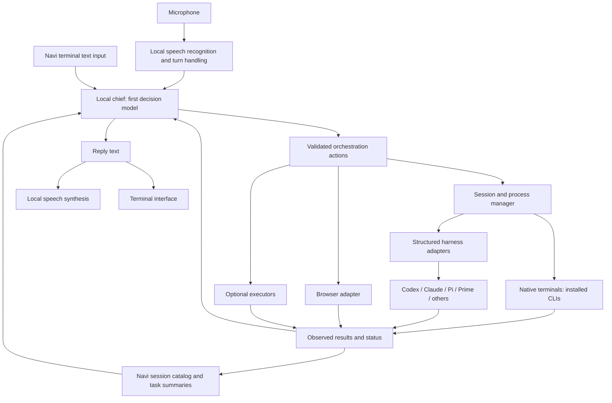

# Navi orchestration options

Date: 2026-10-10. Status: proposal for discussion, not an implementation decision.

The requested product is a terminal orchestration layer with a local chief as its first decision point. Voice communicates directly with that chief. Navi manages projects, sessions, installed agent harnesses, and browser capabilities; each harness continues to own its coding loop.

This document evaluates that direction. It does not supersede the existing plans or authorize removing their functionality.

## 1. Findings from the current workspace

Read: `REFINED-PLAN.md`, `harness.md`, `prime-agent-integration.md`, `local-decision-and-gui-models.md`, `voice-stack.md`, both architecture generations, the Navi package README, browser contracts and CLI implementation, and the upstream server/client/protocol/Chord READMEs.

| Existing assumption | Problem for the requested product | Proposed correction |
| --- | --- | --- |
| Voice sends every utterance into a cloud Prime Agent root session | The local decision model is downstream. A routing skill invoked by that cloud agent cannot eliminate the initial cloud turn. | Voice and Navi text input reach the local chief first. Prime Agent becomes an optional worker. |
| FunctionGemma is the decision tier | Classification alone does not cover conversational references, choosing among sessions, clarification, or multi-step delegation. | Evaluate a small local conversational/tool model as chief. A specialized classifier can be an optional later optimization. |
| The supervisor's session and memory own Navi's context | Switching harnesses would also change the owner of task identity and coordination context. | Navi owns its session catalog and task summaries; harnesses retain their native conversation histories. |
| Terminal control is mostly a shell tool | Launching a process is different from resuming a conversation, focusing a terminal, interrupting a turn, or answering a pending question. | Add a session manager and harness adapters with explicit capabilities. |
| The browser bridge is already the browser-control layer | It implements observation, focus, and scroll only. It has no click, typing, navigation, screenshots, or multi-tab management. | Preserve its transport and authority design; separately select and validate an action backend. |
| A 9B GUI model belongs in the initial stack | Structured browser/session operations do not require screenshot reasoning. Concurrent chief, speech, and vision models have not been measured. | Start with explicit session and browser tools. Add vision for demonstrated gaps. |
| MCP services are the sandbox | MCP is a tool protocol, not process confinement. Browser/desktop services may deliberately control host resources. | Define actual authority and process isolation per executor. |

The foundation in `packages/navi` is real source code, but not a complete assistant. Its README explicitly distinguishes automated contract checks from pending real-browser gates. This review did not rerun those checks or establish live browser behavior.

The broader Pi repository also contains experimental `pi-server`, `pi-client`, and `pi-protocol` components. They offer useful session-routing designs, but are coupled to Pi session/harness interfaces and do not provide adapters for arbitrary installed harnesses. Chord is explicitly standalone and potentially reusable for services; adopting its plugin machinery is optional.

### Local observations

- Fedora 44; Ryzen 5 8645HS; approximately 22 GiB usable RAM.
- NVIDIA driver responds outside the execution sandbox: RTX 4050 Laptop GPU, 6141 MiB VRAM, driver 615.71.09. The first sandboxed GPU query failed; the host query succeeded.
- At the inspection snapshot, RAM available was about 3.2 GiB and swap usage about 4.1 GiB. Model size must account for normal workstation load, not just installed RAM.
- Claude Code 2.1.296 and Codex CLI 0.162.1 report their versions. Pi, Prime Agent, and tmux launchers are present. Prime Agent help advertises RPC and ACP modes as well as daemon/session commands.
- Zen and Firefox are on PATH. The existing extension targets Chromium. No Firefox/Zen adapter has been validated.

These observations establish hardware and integration surfaces, not local model throughput, authenticated harness round trips, or compatibility of every installed feature.

## 2. Product behavior and ownership

Example request: “Open Claude Code for the prayer project, resume the notifications work, and keep my Codex session running.”

The chief resolves the project and candidate session from Navi's catalog. The session manager either resumes the native conversation or launches a new one, focuses the requested terminal view, and reports the actual result. Focus changes do not terminate the other worker. If two sessions match “notifications,” the chief asks which one.

The important distinction is between a terminal view and an agent conversation. A tmux pane can contain a conversation, but its pane ID is not the provider's resume ID.

Proposed records:

- **Project:** a named repository or directory.
- **Workspace:** the concrete checkout, directory, or worktree used by a worker.
- **Task:** a goal and portable coordination summary.
- **Worker session:** harness, native conversation ID, launch mode, workspace, process ownership, and observed status.
- **Presentation:** the terminal or UI currently displaying that worker.

One task can have several worker sessions. Selecting an existing session preserves its native history. Moving work from Claude to Codex creates or selects a different native session and supplies a handoff containing the goal, relevant files, completed work, and pending questions. It does not transfer private provider state or promise identical context.

## 3. Architectural options

| Option | Concrete design | Advantages | Costs and limits |
| --- | --- | --- | --- |
| A. Native terminal workspace | Local chief plus a Navi catalog controlling tmux sessions/windows that run the installed CLIs | Preserves native interfaces, plugins, and daily workflow; broad launch coverage; detach/reattach behavior already exists | Terminal output is not a reliable lifecycle protocol. Fine-grained status, questions, and tool events require hooks or adapters. |
| B. Navi-owned hybrid orchestrator | Local daemon owns catalog, actions, and chief; structured worker adapters where available; native terminals for other harnesses | Matches voice coordination and T3-like session visibility while allowing native CLI use; no mandatory central harness | Navi must maintain adapters, persistence, process ownership, and a terminal UI. Native and structured modes have different capabilities. |
| C. Navi client over T3 Code | Local chief and terminal client issue commands to a T3 backend; Navi adds speech and browser services | Can reuse provider integrations and workspace machinery | Depends on T3's RPC/domain contracts and release cadence. Supporting a terminal client and voice commands needs a feasibility spike; arbitrary CLI and personal-browser control remain separate work. |
| D. One harness as the core | Local chief delegates coordination into a Pi/Prime/Codex root agent that invokes other harnesses | Reuses one existing agent runtime and its automation features | Session state and orchestration inherit that harness's concepts. Moving the cloud agent ahead of the chief would violate the requested entry path. |

Recommendation for discussion: **B**, starting with native terminal sessions and one structured adapter. A is a useful first slice if preserving the exact native interface is the immediate priority. C deserves a bounded comparison if existing provider/worktree integration is more valuable than keeping the runtime small. D is less aligned with making Navi an independent orchestrator.

T3 separates workspace execution from clients and keeps provider-specific behavior behind adapters. Those are useful design precedents. Reusing its backend is a proposed integration, not an established Navi capability. See [T3 architecture](https://github.com/pingdotgg/t3code/blob/main/docs/internals/overview.md) and [provider boundaries](https://github.com/pingdotgg/t3code/blob/main/docs/internals/providers.md). T3's repository has an [MIT license](https://github.com/pingdotgg/t3code/blob/main/LICENSE); code reuse must preserve its notice.

For native mode, tmux is an existing local option for persistent terminal sessions. A directly owned pseudo-terminal (PTY, the process interface used by terminal emulators) would avoid a tmux dependency but require terminal rendering, input, resize, and process recovery work. See [tmux's session model](https://github.com/tmux/tmux/wiki/Getting-Started).

## 4. Proposed hybrid arrangement

The chief interprets intent, asks questions, and delegates. Deterministic code owns process creation, targeting, durable state, and permissions. The chief can run a bounded orchestration tool loop without reproducing the workers' coding harnesses.

Example action vocabulary: `session.list`, `session.create`, `session.resume`, `session.focus`, `session.send`, `session.interrupt`, and selected browser operations. A create action names a registered harness and project; the launcher translates those validated IDs into an executable and argument list. A transcript is not interpolated into a shell command.

Navi should expose capabilities per adapter: launch, native attachment, resume, interrupt, structured events, questions, and any supported in-flight steering. “Installed” should not imply that every capability exists.

MCP can expose browser/executor tools to workers. ACP (Agent Client Protocol) can connect supporting agents to a client. They serve different purposes: MCP is not a replacement for session ownership or a universal harness-control protocol. ACP session loading is capability-gated, so adapters must negotiate rather than assume resume support. See [ACP session setup](https://agentclientprotocol.com/protocol/session-setup).

### Harness integration candidates

| Harness | Native interface | Structured candidate | Remaining validation |
| --- | --- | --- | --- |
| Codex | Installed `codex` in a native terminal | `codex app-server`; create/resume threads, start/interrupt turns, stream events, handle approvals | Generate schemas from the installed version and verify exact behavior. Do not assume all current documentation features exist in that build. |
| Claude Code | Installed `claude` in a native terminal | CLI structured output for bounded jobs; Agent SDK for richer streaming, session, and permission handling | Preserve intended project configuration. Evaluate authentication and product-use constraints before choosing the SDK path. |
| Pi | Installed `pi` in a native terminal | `pi --mode rpc` via its documented JSONL interface | Verify resume/cwd behavior, extensions, cancellation, and installed-version compatibility. |
| Prime Agent | Native attach/session commands | Evaluate advertised ACP/RPC modes; use documented CLI commands where necessary | Its local help establishes the surface, not a tested protocol adapter. Avoid undocumented daemon commands and blind log polling as the main control API. |
| Other installed harness | Registered launcher in a native terminal | ACP or a native protocol when supported | Baseline launch/focus/terminal attachment; richer capabilities added individually. |

Codex's [app-server documentation](https://developers.openai.com/codex/app-server/) covers rich-client integration and version-specific schema generation. The installed CLI also exposes app-server help. The docs mark app-server and WebSocket transport experimental; pin and test an adapter rather than promising a stable protocol.

Claude's [programmatic CLI](https://code.claude.com/docs/en/headless) supports structured output and continuation. The [Agent SDK](https://code.claude.com/docs/en/agent-sdk/overview) provides richer sessions and permissions, but its documentation restricts third-party products offering claude.ai login/rate limits without prior approval. Native CLI launch and SDK-backed product integration should be evaluated separately; the old plan's blanket subscription assumptions are insufficient.

Keep credentials under each worker's existing authentication mechanism. Navi stores references and configuration, not copied OAuth tokens in chief prompts.

### State and recovery

Persist session metadata, native IDs, selected focus, task summaries, and command outcomes in a small local database. SQLite plus an action ledger is a reasonable initial choice. Full event sourcing, distributed scheduling, and a plugin marketplace are optional later complexity.

On restart, reconcile the catalog against the owned processes, tmux handles, or provider APIs. Reattach or resume only through supported mechanisms. A process that was launched outside Navi cannot automatically be taken over. Historical-session import and attachment to a live process are separate capabilities.

Serialize conflicting commands per worker. Preserve pending question IDs and their originating worker. Freeze the target for “tell it…” when the utterance begins; a later focus change must not redirect the message. Record accepted, running, completed, failed, cancelled, and unknown outcomes separately. A command acknowledgement is not successful execution; loss of confirmation after dispatch does not permit blind replay.

## 5. Local chief choices

| Strategy | Fit | Tradeoff |
| --- | --- | --- |
| FunctionGemma alone | Narrow, trained command vocabulary | Inadequate as the assumed general conversational chief without task-specific evidence. Google explicitly says it is not intended as a direct dialogue model. |
| Small conversational/tool model | Session selection, follow-ups, clarification, small orchestration plans | More memory and inference time; requires evaluation of actual session commands and bilingual speech transcripts. |
| Classifier plus conversational chief | Common fixed commands use a specialist; ambiguous requests reach the chief | Adds routing, training, and two model lifecycles. Consider only after measuring a useful advantage. |

The [FunctionGemma card](https://ai.google.dev/gemma/docs/functiongemma/model_card) describes a specialized model intended for further fine-tuning, including multi-turn function calling. It is a possible component, not an established replacement for the chief described here.

Candidate baselines, not a claim to identify the best current model:

- [LFM2.5-1.2B-Instruct](https://huggingface.co/LiquidAI/LFM2.5-1.2B-Instruct): a smaller candidate with Arabic and function calling listed by its publisher. Useful for evaluating CPU responsiveness. Its own card discourages knowledge-intensive/programming use; workers should handle those tasks.
- [Granite 4.1 3B](https://huggingface.co/ibm-granite/granite-4.1-3b): Arabic, dialog, and function calling are listed; an intermediate-size candidate.
- [Qwen3-4B-Instruct-2507](https://huggingface.co/Qwen/Qwen3-4B-Instruct-2507): a non-thinking tool-use candidate from the existing research, with greater model size. Evaluate quantized CPU inference and optional GPU offload.

Start with one chief and a bounded catalog/short summaries. Do not put every worker's full transcript into every decision. CPU residence would reserve GPU capacity for speech; GPU offload may improve response time but creates shared-resource scheduling work.

[llama.cpp](https://github.com/ggml-org/llama.cpp/blob/master/tools/server/README.md) is a serving candidate for CPU/GPU quantized inference and constrained JSON output. Constraining JSON reduces malformed actions; it does not establish the correct project, intent, authority, or calibrated confidence. Model/runtime/chat-template compatibility must be tested together.

## 6. Voice choices

| Option | Path | Assessment |
| --- | --- | --- |
| Modular local voice | Speech recognition -> local chief -> speech synthesis | Recommended baseline. Direct connection to the chief, visible transcripts, interchangeable speech models, one owner of decisions. |
| Conversational voice frontend | Audio model -> explicit local chief tool/API -> audio reply | Can provide richer turn handling, but needs a clear rule that orchestration decisions and results come from the chief. Model selection and bilingual tool behavior remain unmeasured. |
| One audio-capable chief | Local speech model handles audio and orchestration | Fewer conceptual components, but less freedom to select speech quality and decision quality independently. Not established to meet the Arabic/English and hardware requirements. |

Retain Egyptian Arabic plus English code-switching and fully local speech as requirements inherited from `voice-stack.md`. Its exact model choices remain candidates until tested together with the chief. Voice transport need not pass through a worker agent, and workers need not invoke a TTS tool to deliver every reply; Navi can speak normalized results.

Only finalized commands trigger actions. Interim recognition is useful for display, not launching a session before the utterance finishes. Define interruption behavior explicitly: speaking over Navi can stop its audio, while “stop the Codex task” targets worker interruption. Provide a direct cancel control independent of slow model inference. Wake-word listening is optional separately from the architecture; push-to-talk can validate the first loop.

A simple local audio service is enough to prove a first round trip. Pipecat is a framework candidate when turn detection and interruption behavior justify it; see its [speech-input and turn-handling guide](https://docs.pipecat.ai/pipecat/learn/speech-input). It does not remove the need to validate the chosen speech models.

## 7. Browser choices

| Option | User experience | Engineering implication |
| --- | --- | --- |
| Extend Navi's browser bridge | Control selected tabs in the user's existing browser | Reuses narrow transport and document-bound references. Requires actual action implementations, a revised permission model, and a Firefox/Zen platform adapter if that is the target. |
| Playwright-managed browser/profile | Navi controls a dedicated automation browser | Can use existing automation tools; the user may need to log into that profile separately. Browser ownership and concurrent access must be explicit. |
| Playwright extension attachment | Control existing logged-in Chromium tabs | Microsoft's documented extension mode is Chrome/Edge only; it does not solve Zen/Firefox integration. |
| Desktop vision and input | Interact with browser chrome, canvas, and other desktop UI | Broadest surface, but needs capture, target identification, input permissions, a model, and measured postconditions. Add for tasks structured adapters cannot cover. |

Microsoft documents persistent/isolated browser profiles and existing-tab attachment in [Playwright MCP](https://github.com/microsoft/playwright-mcp). These are alternatives to building every browser operation, not already-integrated Navi capabilities.

Firefox supports [native messaging](https://developer.mozilla.org/en-US/docs/Mozilla/Add-ons/WebExtensions/Native_messaging), but its extension background environment differs from Chrome's. The current service-worker manifest cannot simply be declared Firefox-compatible; see [MDN's background compatibility](https://developer.mozilla.org/en-US/docs/Mozilla/Add-ons/WebExtensions/manifest.json/background).

The existing bridge requires explicit popup attachment, one document, and fresh attachment after navigation. A voice command outside Chrome is not itself a documented `activeTab`-granting gesture. Continuous voice navigation therefore requires a chosen permission/attachment design. See [Chrome's activeTab contract](https://developer.chrome.com/docs/extensions/develop/concepts/activeTab). Changing that design would also require revising the foundation's current permission invariants.

A browser debugging-port shortcut is not a generic way to attach to the user's normal Chrome profile: Chrome changed default-profile behavior beginning with version 136. See [Chrome's debugging changes](https://developer.chrome.com/blog/remote-debugging-port).

Prefer DOM/accessibility-based operations where possible. Preserve freshness checks and confirm actual results before announcing success. Page content must not acquire session-launch authority. Browser coordination belongs in Navi so multiple workers cannot silently issue conflicting commands to the same tab.

## 8. Implementation-language and reuse choices

| Choice | Benefit | Cost |
| --- | --- | --- |
| TypeScript daemon/UI plus separate Python audio service | Closest to the current bridge, Pi RPC ecosystem, and T3 client/backend types | Requires a managed Node runtime and separate audio process. Reusing Pi's terminal library does not require embedding its coding harness. |
| Rust daemon/TUI plus Python audio | Strong process/lifecycle types and native terminal ecosystem | Additional language boundary and more work to reuse the present TypeScript browser core or a T3 backend. |
| Python core/audio plus terminal frontend | Speech integration is convenient | Less direct reuse of the current bridge, schemas, and TypeScript components. |

For B, TypeScript is the lowest-change candidate. Keep the chief's serving process and audio service behind explicit local interfaces. A user daemon can outlive terminal attachment; the browser connector remains a relay. This intentionally revises the foundation's diagnostic-CLI lifecycle once the new product direction is accepted.

Do not assume Pi's experimental server becomes the generic orchestrator merely because it is nearby. Reuse individual routing, cancellation, terminal, or service components when they satisfy the selected boundary. Decide whether to stay inside the Pi fork or extract a standalone Navi workspace after that assessment; extraction is not required to validate the first session workflow.

## 9. Decisions and evidence needed before implementation

The main product decision is **native harness screens versus a unified Navi conversation interface**, or a hybrid supporting both with different capabilities. The browser decision is **the existing Zen/Firefox profile versus a managed automation browser**. Those choices have more architectural impact than the exact speech model.

Suggested validation order after selecting a direction:

1. Text-driven session creation, naming, focus, resume, and detach with native terminals. Prove that switching views leaves other workers running.
2. One structured adapter, starting with Codex. Verify questions, interruption, native IDs, recovery, and installed-version behavior.
3. Compare the local chief candidates on roughly 50 real orchestration requests: English, Egyptian Arabic, code-switching, ambiguous references, changing focus, unavailable harnesses, and correction after a wrong recognition. Measure action correctness, clarification behavior, latency, RAM, and VRAM.
4. Connect local speech directly to the chief. Measure recognition, endpointing, model decision, executor response, and time to first spoken audio separately under normal workstation load.
5. Validate the selected browser backend on real tabs and navigation. Add click/type/navigation only with appropriate target and outcome checks.

These are proposed experiments, not work performed in this review. Cyber tools, desktop vision, schedules, and autonomous goals can remain later executor capabilities; the new direction does not require deleting them or making them prerequisites for session orchestration.

Acceptance should include “Navi can select and launch sessions without a cloud supervisor,” “changing focus cannot misroute a queued voice message,” and “restart does not duplicate a worker or replay an uncertain action.” Set response-time targets from measurements rather than retaining the old plan's unverified sub-100ms router or 1.5-second voice-loop claims.
